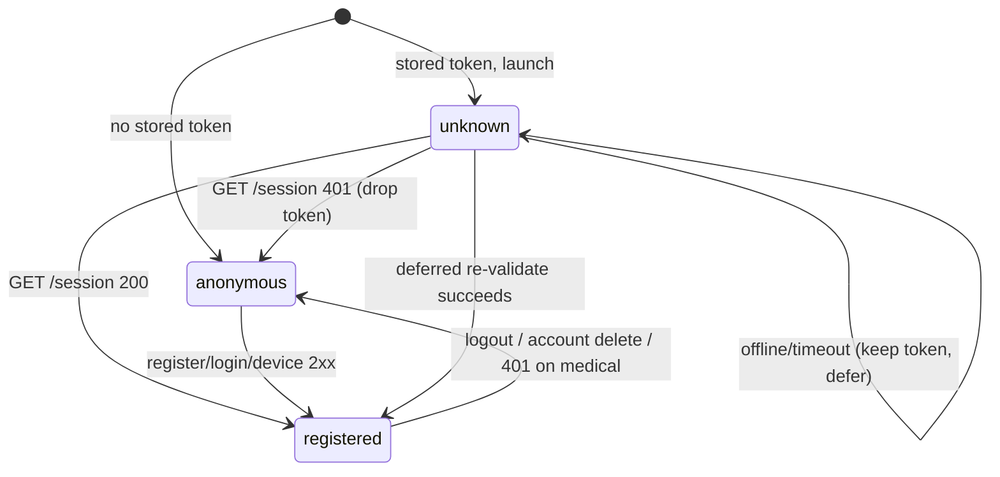

# Design Document

## Overview

This feature adds the **citizen account and medical-profile UI** to `apps/mobile` (React Native /
Expo). Today the app is a single, frozen Tier-0 surface: `App.tsx` renders exactly one screen,
`EmergencyGridScreen`, backed by a mock mesh transport. This design adds a set of **Secondary_Surfaces**
(register, login, profile/account hub, medical editor) that are reached *from* the SOS grid, consume the
**already-existing** `/api/citizen/*` backend in `apps/web`, persist the session on-device, and degrade
honestly to "unavailable offline" — while leaving the survival core (the SOS grid and its mesh wire
format) completely untouched.

The design is constrained by one product law that dominates every decision: **the SOS grid is the first
screen and is never gated by an account** (PRODUCT.md §6, R1). Accounts and the medical profile are
**optional, Tier-2 online enrichment** (PRODUCT.md §1a/§1b) reached from a secondary affordance and must
never block, delay, or add latency to a Tier-0 SOS action.

### What this design adds

- **Mobile UI**: a lightweight, state-driven screen switch over the existing grid; register / login /
  account-hub / medical-editor screens; an "unavailable offline" treatment for every Tier-2 surface.
- **On-device persistence**: a `Session_Store` over `expo-secure-store` holding the opaque session token
  and device key.
- **A citizen API client**: base-URL config, 10 s timeouts, explicit cookie handling (the top design
  risk — see §Security and §Risk), connectivity detection, and error→copy mapping.
- **Exactly one backend addition**: a citizen **account-deletion** endpoint (`DELETE /api/citizen/account`),
  required by SECURITY.md §7.5 and R10, specified to match the existing citizen handler patterns.

### What this design explicitly does NOT touch

The four-category closed enum (SUNOG/MEDIKAL/KRIMEN/BAHA), the frozen mesh wire format, the outbox, the
`MockMeshTransport`, and the grid's offline-first behaviour (R1.7). No voice / chat / AI / STT / SMS / OTP
surface is introduced anywhere (R12.3/R12.7, PRODUCT.md §2). No new emergency categories, no telco, no
real email verification, no WebSockets.

### Verified backend contracts (consumed, not re-specified)

Read from the live source in `apps/web`. These are the exact shapes the mobile client codes against.

| Route | Method | Success | Body in | Body out / headers |
| --- | --- | --- | --- | --- |
| `/api/citizen/register` | POST | `201` | `{email,password}` | `{ok:true,citizen:{id,email,emailVerified}}` + `Set-Cookie: aira_citizen_session` |
| `/api/citizen/login` | POST | `200` | `{email,password}` | same as register |
| `/api/citizen/device` | POST | `200` | `{deviceKey}` | same as register (register-or-login in one step) |
| `/api/citizen/session` | GET | `200` | – | `{ok:true,citizen}` (or `401 unauthenticated`) |
| `/api/citizen/session` | DELETE | `204` | – | cleared cookie (**this is logout** — see note) |
| `/api/citizen/medical` | GET | `200` | – | `{ok:true,profile}` (`no-store`) |
| `/api/citizen/medical` | PUT | `200` | profile body | `{ok:true,profile}` canonical |
| `/api/citizen/medical` | DELETE | `204` | – | – |

**Note (logout route):** there is no `/api/citizen/logout` route in the codebase. `handleCitizenLogout`
is wired to **`DELETE /api/citizen/session`** (`apps/web/app/api/citizen/session/route.ts`). The
requirements refer to it as "`/api/citizen/logout`"; this design maps that intent onto the actual route
`DELETE /api/citizen/session`. This is a documentation reconciliation, not a backend change.

**Error contract** (from `citizen-handlers.ts` / `medical-handlers.ts` / `http.ts`), all shaped
`{ok:false,error:"<code>",...}`:

| Status | `error` code | Extra | Source |
| --- | --- | --- | --- |
| 400 | `invalid_email` | – | register |
| 400 | `weak_password` | `{problem}` | register |
| 400 | `invalid_credentials` | – | register/login (missing/oversized fields) |
| 400 | `invalid_device_key` | – | device |
| 400 | `invalid_json` | – | all mutations |
| 401 | `invalid_credentials` | – | login (wrong email/password) |
| 401 | `unauthenticated` | – | session/medical/account |
| 403 | `forbidden_origin` | – | all same-origin-guarded mutations |
| 409 | `registration_unavailable` | – | register (generic, no enumeration) |
| 423 | `account_locked` | `{retryAfterSeconds}` + `retry-after` header | login |
| 429 | `rate_limited` | `retry-after` header | register/login |
| 503 | `service_unavailable` | – | any route when DB not configured |

**Medical bounds** (from `apps/web/src/lib/medical/profile.ts`) — the client MUST mirror these exactly
(R7.7): `BLOOD_TYPES` = 8 values, `AGE_BANDS` = 5 values, `MAX_ITEMS` = 20, `MAX_ITEM_LEN` = 80,
`MAX_NOTES_LEN` = 1000, `MAX_CONTACTS` = 5, `MAX_NAME_LEN` = 80, `MAX_PHONE_LEN` = 32,
`MAX_RELATION_LEN` = 40.

---

## Architecture

### Guiding principles

1. **The grid is the root and is never unmounted.** Secondary surfaces are rendered *over or beside* the
   grid via a state-driven screen switch. The grid never depends on auth or connectivity (R1.1/R1.2/R1.4,
   R11.3).
2. **Tier isolation.** The citizen API client lives entirely in `apps/mobile` and talks only to
   `/api/citizen/*`. It never carries a responder credential and never reaches a responder/platform route
   (R12.2).
3. **DOM-free shared core.** The app imports platform-neutral logic from `@aira/ui` (categories, mesh,
   outbox, payload, `t()`). It MUST NOT import `@aira/ui/web` (DOM-only Radix/`lucide-react`). Icons use
   `lucide-react-native`; tokens come from `@aira/tailwind-config` via NativeWind (R12.6).
4. **No literals in components.** Every user-visible string is added to `packages/ui/src/i18n.ts` and read
   via `t()` (R12.5).

### Navigation decision: state-driven screen switch, no router library

**Decision:** Implement screen selection with a small React state machine (`AppNavigator`) holding a
union-typed `Screen` value, **not** a navigation library.

**Rationale:**

- The app has one root (the grid) and a shallow, finite set of modal-like secondary screens. There is no
  deep linking, no nested stacks, no URL routing, no tab bar. A router (`@react-navigation/*` +
  `react-native-screens` + `react-native-safe-area-context` + gesture-handler) adds multiple native
  dependencies and install-script surface against a hard **< 30 MB** budget (PRODUCT.md §2, AGENTS.md
  rule 10: "no new dependencies without checking").
- A state-driven switch keeps the grid literally mounted as the first child, which is the cleanest way to
  guarantee R1.1/R1.4/R11.3 (the grid is never gated and never re-rendered by auth/connectivity changes).
- It mirrors the pattern already in the repo: the grid itself is a self-contained screen with injectable
  dependencies and no router.

**Consequence:** `App.tsx` changes from rendering `EmergencyGridScreen` directly to rendering
`AppNavigator`, whose default screen is the grid. The grid retains its current props/behaviour verbatim.

### New dependencies (the only ones this feature adds)

Per AGENTS.md rule 10, each is justified and minimal:

| Package | Why | Budget note |
| --- | --- | --- |
| `expo-secure-store` | R6.6 requires the device's **secure storage facility** (Keychain / Keystore) for the session token + device key. First-party Expo module. | Tiny; native-backed. |
| `lucide-react-native` | R12.6 requires the Lucide icon set; `lucide-react` from `@aira/ui/web` is DOM-only. | Tree-shaken SVG icons; import only the few used. |
| `@react-native-community/netinfo` (candidate) | R11 connectivity detection. **Alternative preferred:** derive connectivity from request outcome (timeout / network error) and skip this dep. See §Connectivity. | Avoided if possible. |

`fast-check` is already present in the monorepo (`packages/ui` devDependency) and is reused for
property-based tests; `@testing-library/react-native` + `jest-expo` are already configured in
`apps/mobile`.

### Component / navigation diagram

```mermaid
flowchart TD
    App[App.tsx] --> Nav[AppNavigator - screen state machine]

    Nav -->|root, always mounted, never gated| Grid[EmergencyGridScreen - FROZEN Tier-0]
    Nav -->|secondary| Hub[AccountHubScreen]
    Nav -->|secondary| Reg[RegisterScreen]
    Nav -->|secondary| Login[LoginScreen]
    Nav -->|secondary| Med[MedicalProfileScreen]

    Hub --> Reg
    Hub --> Login
    Hub --> Med

    subgraph State[Auth + connectivity state]
      AuthState[CitizenAuthState: anonymous / registered]
      Conn[Connectivity: online / offline / unknown]
    end
    Nav -. reads .-> AuthState
    Hub -. reads .-> AuthState
    Med -. reads .-> AuthState

    subgraph Client[apps/mobile citizen client]
      ApiClient[CitizenApiClient - fetch + timeout + cookie jar]
      Store[SessionStore - expo-secure-store]
      ErrMap[errorToCopyKey mapping]
    end

    Reg --> ApiClient
    Login --> ApiClient
    Hub --> ApiClient
    Med --> ApiClient
    ApiClient --> Store
    ApiClient --> ErrMap

    ApiClient -->|HTTPS only| Backend[(apps/web /api/citizen/*)]

    subgraph Shared[@aira/ui - DOM-free]
      I18n[t / i18n.ts]
      Core[categories / mesh / outbox / payload]
    end
    Grid --> Core
    Grid --> I18n
    Reg --> I18n
    Login --> I18n
    Med --> I18n
    Hub --> I18n

    classDef frozen fill:#1b2a4a,stroke:#4a90d9,color:#fff;
    class Grid frozen;
```

### Launch / session-restore flow

```mermaid
sequenceDiagram
    participant U as App launch
    participant Nav as AppNavigator
    participant S as SessionStore
    participant C as CitizenApiClient
    participant B as Backend

    U->>Nav: mount
    Nav->>Nav: render SOS grid immediately (R1.1, R6.4)
    Nav->>S: read session token
    alt no token
        Nav->>Nav: state = anonymous
    else token present
        Nav->>C: GET /api/citizen/session (10s timeout)
        alt 200
            C-->>Nav: registered(citizen)
        else 401 unauthenticated
            Nav->>S: delete token
            Nav->>Nav: state = anonymous (R6.3)
        else offline / timeout / network error
            Nav->>Nav: keep token, state = unknown; defer re-validate (R6.4)
        end
    end
    Note over Nav: The grid was interactive the entire time.
```

---

## Components and Interfaces

All new code lives under `apps/mobile/src`. Shared logic (device-key generation helper, error mapping,
validation bounds) that is **pure and DOM-free** MAY be placed in `@aira/ui` so it is unit-testable with
the existing `fast-check` + `vitest` setup; UI components stay in `apps/mobile` and are tested with
`jest-expo`.

### 1. `AppNavigator` (`src/navigation/AppNavigator.tsx`)

The root component. Owns the screen state and the auth/connectivity context; renders the grid as the
default screen.

```ts
type Screen =
  | { readonly name: 'grid' }
  | { readonly name: 'accountHub' }
  | { readonly name: 'register' }
  | { readonly name: 'login' }
  | { readonly name: 'medical' };

interface AppNavigatorProps {
  // Injectable for tests; defaults to the real secure-store-backed client.
  readonly client?: CitizenApiClient;
  readonly store?: SessionStore;
}
```

- Default `screen = { name: 'grid' }` (R1.1).
- A single secondary affordance on the grid header (an account icon from `lucide-react-native`) switches
  to `accountHub` (R1.3). The grid remains mounted underneath; switching back requires no auth (R1.5).
- Runs the launch session-restore flow (R6.1–R6.4) in an effect; the grid renders before and during it.

### 2. `CitizenAuthProvider` + `useCitizenAuth` (`src/auth/CitizenAuthContext.tsx`)

React context holding the auth state model (see Data Models). Exposes actions that wrap the API client
and keep the `SessionStore` and state in sync:

```ts
interface CitizenAuth {
  readonly state: CitizenAuthState;            // anonymous | registered | unknown
  readonly connectivity: Connectivity;          // online | offline | unknown
  register(email: string, password: string): Promise<AuthOutcome>;
  login(email: string, password: string): Promise<AuthOutcome>;
  deviceAuth(): Promise<AuthOutcome>;           // R3: generate/reuse key, retry-once
  restore(): Promise<void>;                     // R6 launch validation
  logout(): Promise<void>;                      // R5: always clears local state
  deleteAccount(): Promise<AccountDeleteOutcome>;// R10
}

type AuthOutcome =
  | { readonly ok: true }
  | { readonly ok: false; readonly copyKey: MessageKey; readonly retryAfterSeconds?: number };
```

The provider NEVER stores a password or device key in React state beyond the single call that uses it;
the password is dropped as soon as the request resolves (R2.8/R4.6).

### 3. `CitizenApiClient` (`src/api/citizenClient.ts`)

See the dedicated contract in §API client contract below.

### 4. `SessionStore` (`src/storage/sessionStore.ts`)

Thin wrapper over `expo-secure-store` (R6.6). It is the ONLY module allowed to read/write the two
secrets.

```ts
interface SessionStore {
  getSessionToken(): Promise<string | null>;
  setSessionToken(token: string): Promise<void>;
  clearSessionToken(): Promise<void>;
  getDeviceKey(): Promise<string | null>;
  setDeviceKey(key: string): Promise<void>;
  clearDeviceKey(): Promise<void>;
}
```

Keys: `aira.citizen.session` and `aira.citizen.deviceKey`. Values are written with
`SecureStore.setItemAsync` (Keychain/Keystore-backed). Neither value is ever passed to `console`,
analytics, or a URL (R6.5, R12).

### 5. Screens (`src/screens/`)

- `AccountHubScreen` — the Secondary_Surface entry point. In anonymous state, offers Register / Login /
  device-key (R1.3, R2.1). In registered state, shows the citizen email (if any), Medical profile entry,
  Sign out (R5), and Delete account (R10). Every Tier-2 row renders the offline treatment when
  `connectivity === 'offline'` (R11.1/R11.2).
- `RegisterScreen` — email + password fields (R2.1), submit → `register`. Maps each error to copy and
  retains the entered email on `invalid_email` (R2.4). Disables submit during the `retry-after` window on
  `rate_limited` (R2.7).
- `LoginScreen` — email + password fields, submit → `login`. Maps `invalid_credentials` /
  `account_locked` (with retry window from `retryAfterSeconds`) / `rate_limited` (R4.3–R4.5).
- `MedicalProfileScreen` — loads via GET on open with a 10 s timeout (R7.1), empty-state (R7.2),
  retryable load failure (R7.3), bounded editors for all fields (R7.4–R7.7), save via PUT (R7.8), 401 →
  drop session + go to login (R7.9), save failure preserves edits (R7.10), delete profile with
  confirmation (R9). Contacts sub-editor (R8). Never requests device-contacts/mic/camera/media/SMS
  permissions (R7.12).

### 6. Shared pure helpers added to `@aira/ui`

Added to the DOM-free core so they are reusable and property-testable with `fast-check`:

- `generateDeviceKey(randomBytes: (n: number) => Uint8Array): string` — 32 random bytes → 43-char
  base64url, matching the server's `DEVICE_KEY_PATTERN = /^[A-Za-z0-9_-]{43}$/` (R3.1). The randomness
  source is injected (`expo-crypto`'s `getRandomBytes` in the app; a seeded generator in tests).
- `MEDICAL_BOUNDS` — a single exported constant mirroring the server bounds, imported by both the client
  validator and its tests so they can never silently drift (R7.7). (The canonical values stay in
  `apps/web`; this is a mirror with a cross-checked test.)
- `validateMedicalDraft(draft): ValidationResult` — pure client-side validation returning per-field copy
  keys (R7.7, R8.4).
- `errorToCopyKey(route, status, code): MessageKey` — pure mapping from an API error to a Copy_Catalog
  key (the error→copy table below).

---

## Data Models

### Auth state model (anonymous ↔ registered)

```ts
type CitizenView = { readonly id: string; readonly email: string | null; readonly emailVerified: boolean };

type CitizenAuthState =
  | { readonly kind: 'anonymous' }
  | { readonly kind: 'registered'; readonly citizen: CitizenView }
  | { readonly kind: 'unknown' };   // token exists but not yet validated (offline at launch, R6.4)
```



The grid's interactivity is **invariant across every state above** — the grid subscribes to none of this
state (R1.4, R11.3). This is Correctness Property 1.

### Connectivity model

```ts
type Connectivity = 'online' | 'offline' | 'unknown';
```

Derived primarily from request outcomes (a timeout or network error flips the relevant surface to
`offline`); see §Connectivity for why a dedicated NetInfo dependency is avoided if possible.

### Medical draft model (client-side, mirrors `MedicalProfile`)

```ts
interface MedicalDraft {
  bloodType: BloodType | null;                // BLOOD_TYPES ∪ {null}
  ageBand: AgeBand | null;                     // AGE_BANDS ∪ {null}
  allergies: string[];                         // ≤ MAX_ITEMS, each ≤ MAX_ITEM_LEN
  conditions: string[];
  medications: string[];
  notes: string | null;                        // ≤ MAX_NOTES_LEN
  contacts: EmergencyContactDraft[];           // ≤ MAX_CONTACTS
}
interface EmergencyContactDraft { name: string; phone: string; relation: string | null; }
```

```ts
// Single source of mirrored bounds (R7.7). Cross-checked against apps/web by a test.
const MEDICAL_BOUNDS = {
  MAX_ITEMS: 20, MAX_ITEM_LEN: 80, MAX_NOTES_LEN: 1000,
  MAX_CONTACTS: 5, MAX_NAME_LEN: 80, MAX_PHONE_LEN: 32, MAX_RELATION_LEN: 40,
} as const;
```

The draft is the in-progress edit buffer; it is **preserved for the app session** across failed/offline
saves (R7.10, R11.4/R11.5) and only replaced by the canonical server profile on a `200` PUT/GET (R7.8,
R8.5).

### API client contract

```ts
interface CitizenApiClient {
  register(email: string, password: string): Promise<ApiResult<CitizenView>>;
  login(email: string, password: string): Promise<ApiResult<CitizenView>>;
  deviceAuth(deviceKey: string): Promise<ApiResult<CitizenView>>;
  getSession(): Promise<ApiResult<CitizenView>>;
  logout(): Promise<ApiResult<void>>;            // DELETE /api/citizen/session
  getMedical(): Promise<ApiResult<MedicalProfile>>;
  putMedical(draft: MedicalDraft): Promise<ApiResult<MedicalProfile>>;
  deleteMedical(): Promise<ApiResult<void>>;
  deleteAccount(): Promise<ApiResult<void>>;      // DELETE /api/citizen/account (new)
}

type ApiResult<T> =
  | { readonly ok: true; readonly status: number; readonly data: T }
  | { readonly ok: false; readonly kind: 'http'; readonly status: number; readonly code: string;
      readonly retryAfterSeconds?: number }
  | { readonly ok: false; readonly kind: 'offline' }       // network error
  | { readonly ok: false; readonly kind: 'timeout' };       // exceeded 10s
```

**Behaviour:**

- **Base URL**: a single `AIRA_CITIZEN_API_BASE` config value (from `app.json` `extra` / env), required to
  be `https://…` in release builds (R12.4). The client refuses a non-HTTPS base outside development.
- **Timeout**: every request uses `AbortController` with a 10 000 ms deadline (R3.3, R7.1/R7.8). Exceeding
  it yields `{ ok:false, kind:'timeout' }`.
- **Cookie handling** (the critical part — see §Security / §Risk): the client maintains a **manual cookie
  jar**. It reads `set-cookie` from register/login/device responses, extracts the `aira_citizen_session`
  value, persists it via `SessionStore`, and attaches it as a `Cookie: aira_citizen_session=<token>`
  header on every subsequent request. On logout / account-delete / `401`, it clears the jar and store.
- **No Origin header**: native fetch sends no browser `Origin`, and `isSameOrigin()` treats a missing
  Origin + non-cross-site `sec-fetch-site` as same-origin — so the mobile client passes the server's CSRF
  guard without special handling. Verified in `http.ts`.
- **Error mapping**: non-2xx responses are parsed into `{ code, retryAfterSeconds }`; `errorToCopyKey`
  turns them into a Copy_Catalog key for the screen.
- **No secret logging**: the client never logs request bodies, the cookie, the device key, or any medical
  field (R2.8/R4.6/R6.5/R7.11/R10.7/R12).

### Error → Copy_Catalog mapping

New keys to be added to `packages/ui/src/i18n.ts` (no literals in components, R12.5). Codes reuse
existing keys where one already fits (e.g. `rate_limited`).

| Route | Status / code | Copy key (new unless noted) | Notes |
| --- | --- | --- | --- |
| register | 400 `invalid_email` | `citizenInvalidEmail` | retain entered email (R2.4) |
| register | 400 `weak_password` | `citizenWeakPassword` | R2.5 |
| register | 409 `registration_unavailable` | `citizenRegistrationUnavailable` | generic, no enumeration (R2.6) |
| register/login | 429 `rate_limited` | `citizenRateLimited` | disable submit for `retry-after` s (R2.7/R4.5) |
| login | 401 `invalid_credentials` | `citizenInvalidCredentials` | no email/password distinction (R4.3) |
| login | 423 `account_locked` | `citizenAccountLocked` | `{minutes}` from `retryAfterSeconds` (R4.4) |
| device | 400 `invalid_device_key` (after 1 retry) | `citizenDeviceRetryFailed` | R3.5 |
| device | other / timeout / network | `citizenDeviceUnavailable` | keep key, stay pre-registration (R3.6) |
| medical GET | non-200 / timeout / network (not 401) | `citizenMedicalLoadFailed` | keep surface open + retry (R7.3) |
| medical PUT | non-200 / timeout / network (not 401) | `citizenMedicalSaveFailed` | preserve edits (R7.10) |
| medical | client validation | `citizenMedicalInvalid`, `citizenContactInvalid` | R7.7/R8.4 |
| medical DELETE | offline | `citizenOfflineUnavailable` | retain displayed profile (R9.4) |
| any Tier-2 | network error | `citizenOfflineUnavailable` | honest offline (R11.1/R11.5) |
| session/medical/account | 401 `unauthenticated` | `citizenSessionExpired` | drop session (R6.3/R7.9) |

### New backend endpoint: `DELETE /api/citizen/account` (R10)

The one genuine backend addition. Designed minimally and consistently with `citizen-handlers.ts`.

**Handler** `handleCitizenAccountDelete(request, deps)` in `apps/web/src/lib/api/citizen-handlers.ts`:

```ts
export async function handleCitizenAccountDelete(request: Request, deps: AppDeps): Promise<Response> {
  if (!isSameOrigin(request)) return errorResponse(403, 'forbidden_origin');        // R10.3
  const principal = await authenticateCitizen(request, deps);
  if (!principal) return errorResponse(401, 'unauthenticated');                     // R10.2

  await deleteCitizenAccount(deps.citizen, deps.medical, principal);                // R10.1/R10.4/R10.5

  return new Response(null, {                                                        // R10.4
    status: 204,
    headers: { ...NO_STORE_HEADERS,
      'set-cookie': serializeClearedCitizenSessionCookie({ secure: deps.secureCookies }) },
  });
}
```

**Route** `apps/web/app/api/citizen/account/route.ts` exposing `DELETE`, following the exact
`getAppDeps()` → `503 service_unavailable` guard used by the other citizen routes.

**Service** `deleteCitizenAccount(citizenDeps, medicalDeps, principal)` (new, in `citizen/service.ts`):
1. `revokeSession(principal.sessionId, { at: now, reason: 'account_deleted' })` (R10.4).
2. `deleteOwnProfile(medicalDeps, principal.citizenId)` — reuses the **existing** `MedicalStore.remove`
   (already present; no new medical primitive needed).
3. `store.deleteCitizen(principal.citizenId)` — the **one new store primitive**.

**Store primitives — existing vs new:**

| Needed | Status |
| --- | --- |
| revoke the session | **exists** (`CitizenStore.revokeSession`) |
| delete the medical profile | **exists** (`MedicalStore.remove` via `deleteOwnProfile`) |
| delete the citizen identity + contacts | **NEW** `CitizenStore.deleteCitizen(id)` on the port + `createPostgresCitizenStore` (a parameterised `delete from public.citizens where id = $1`; contacts live inside the encrypted medical row, so removing identity + medical row removes contacts) |

Cascade: `citizen_sessions` rows should be removed by an `ON DELETE CASCADE` FK on `citizen_id`
(migration note); if the migration is not present, the service revokes the current session explicitly and
leaves expired rows to be reaped — the account row deletion is the authoritative removal.

**Anonymous incidents are untouched** (R10.5): anonymous mesh incidents carry no `citizen_id`; the delete
statement targets only `public.citizens` (+ its medical row), so no incident is referenced or modified.

**No value logging** (R10.7): the handler and service log neither identity, profile, nor contact values.

---

## Correctness Properties

*A property is a characteristic or behavior that should hold true across all valid executions of a
system — essentially, a formal statement about what the system should do. Properties serve as the bridge
between human-readable specifications and machine-verifiable correctness guarantees.*

These properties are implemented as property-based tests (`fast-check`, already available in the
monorepo) running a minimum of 100 iterations each. Pure helpers (`generateDeviceKey`,
`validateMedicalDraft`, `errorToCopyKey`, the session-restore reducer, the device-auth request-sequence
model, and the cookie extractor) are DOM-free and testable in `@aira/ui`; grid-invariance and
secret-non-leak properties drive the client/provider with `fast-check`-generated states under
`jest-expo`.

### Property 1: The SOS grid is interactive under every auth and connectivity state

*For any* combination of `CitizenAuthState` (anonymous / registered / unknown) and `Connectivity`
(online / offline / unknown), when `AppNavigator` mounts, the SOS grid is the first interactive screen
and every Tier-0 SOS action (all four categories) submits to the outbox without being blocked, disabled,
or delayed.

**Validates: Requirements 1.1, 1.2, 1.4, 1.6, 11.3**

### Property 2: Session-restore maps each launch outcome to the correct state

*For any* launch session-validation outcome in {`200`, `401 unauthenticated`, offline/timeout/network},
the resulting state is exactly: `200 → registered`; `401 → anonymous` with the stored token cleared;
offline/timeout/network `→ unknown` with the stored token retained for deferred re-validation.

**Validates: Requirements 6.1, 6.2, 6.3, 6.4**

### Property 3: Client requests target only the citizen tier and the device key leaves only via `/device`

*For any* sequence of operations invoked on `CitizenApiClient`, every outbound request URL is under
`/api/citizen/`, the citizen session cookie is attached only to those requests, and the device key value
appears in the body of `/api/citizen/device` requests only — never in any other request, URL, or log.

**Validates: Requirements 3.7, 12.2**

### Property 4: Credentials and session tokens never leak to logs or URLs

*For any* password string and *any* session token, after invoking register / login / device-auth /
session / logout, the password never appears in `SessionStore` contents, captured log output, or any
constructed URL; the session token is never written to logs, analytics, or a URL and is transmitted only
as the `Cookie` header value.

**Validates: Requirements 2.8, 4.6, 6.5**

### Property 5: Logout always clears the local session regardless of backend reachability

*For any* logout response outcome in {`204`, 5xx, timeout, network error}, after logout completes the
`SessionStore` holds no session token and the auth state is anonymous.

**Validates: Requirements 5.2, 5.3**

### Property 6: Device-key authentication is a bounded, reuse-first retry

*For any* existing-or-absent stored device key and *any* sequence of `/device` responses, the client
reuses an existing valid stored key rather than regenerating it, issues at most two `/device` requests
(one retry after a single `400 invalid_device_key`), and ends holding a session if and only if some
response was `200`.

**Validates: Requirements 3.2, 3.5**

### Property 7: Every known API error maps to a defined Copy_Catalog key

*For any* `(route, status, errorCode)` triple drawn from the documented citizen error contract,
`errorToCopyKey` returns a defined `MessageKey` that resolves to a non-empty string via `t()`; no known
error produces an undefined or raw-token message.

**Validates: Requirements 2.4, 2.5, 2.6, 2.7, 4.3, 4.4, 7.3, 11.1**

### Property 8: Medical profile fields never leak to logs

*For any* `MedicalDraft` (including all generated field values and contacts), invoking
`getMedical` / `putMedical` / `deleteMedical` writes no profile field value (blood type, age band,
allergies, conditions, medications, notes, contact name/phone/relation) to any captured log, analytics,
or error-report sink.

**Validates: Requirements 7.11**

### Property 9: In-progress edits survive every non-success save outcome

*For any* `MedicalDraft` and *any* save failure outcome in {non-200 HTTP (other than 401), timeout,
network/offline error}, after a save attempt the draft is unchanged from what the Citizen entered and a
save-/offline-failure copy is shown while the surface stays open and interactive.

**Validates: Requirements 7.10, 11.5**

### Property 10: Client validation accepts a draft iff it is within the mirrored bounds, and rejection blocks the PUT

*For any* `MedicalDraft`, `validateMedicalDraft` returns valid if and only if `bloodType ∈ BLOOD_TYPES ∪
{null}`, `ageBand ∈ AGE_BANDS ∪ {null}`, each of `allergies`/`conditions`/`medications` has at most
`MAX_ITEMS` entries of length at most `MAX_ITEM_LEN`, `notes` is at most `MAX_NOTES_LEN`, there are at
most `MAX_CONTACTS` contacts each with a non-empty name (≤ `MAX_NAME_LEN`) and non-empty phone
(≤ `MAX_PHONE_LEN`) and relation (≤ `MAX_RELATION_LEN`); and whenever validation fails, `putMedical` is
never called.

**Validates: Requirements 7.4, 7.5, 7.7, 8.4**

### Property 11: Client bounds never exceed server bounds

*For any* bound in the mirrored `MEDICAL_BOUNDS` constant, its value equals the corresponding constant in
`apps/web/src/lib/medical/profile.ts` and never exceeds it, so a draft the client accepts is always
within what the server will store without truncation.

**Validates: Requirements 7.7, 8.5**

### Property 12: Contact edits are reflected exactly in the next PUT body

*For any* sequence of add/remove/edit operations on the contacts list, the `contacts` array in the next
`putMedical` request body equals the contacts remaining in the validated draft (added contacts present,
removed contacts absent), with no extra or missing entries.

**Validates: Requirements 8.2, 8.3**

---

## Error Handling

- **Transport failures.** The client distinguishes `timeout` (AbortController after 10 s) from `offline`
  (fetch throws a network error). Both are surfaced as non-blocking messages; the current surface stays
  open and interactive, and any in-progress medical edits are preserved for the app session (R7.10, R11.5).
- **HTTP errors.** Parsed into `{ status, code, retryAfterSeconds }` and mapped through `errorToCopyKey`
  to a Copy_Catalog key (table in Data Models). Unknown/unexpected codes fall back to a generic
  `citizenGenericError` key rather than rendering a raw token or status number.
- **401 `unauthenticated`.** Treated as session loss everywhere: the stored token is cleared and the auth
  state drops to anonymous; on the medical PUT path the Citizen is returned to the login surface (R7.9,
  R6.3).
- **423 / 429.** The `retry-after` / `retryAfterSeconds` value drives a disabled-submit countdown; submit
  re-enables when it elapses (R2.7, R4.4, R4.5). Lock minutes are derived as `max(1, ceil(seconds/60))`.
- **Device-key path.** A single `400 invalid_device_key` discards the stored key, regenerates, and
  retries once; a second failure shows the retry copy and retains no session but keeps the (newly
  generated) key (R3.5). Any other non-200 / timeout / network keeps the existing key and stays
  pre-registration (R3.6).
- **Server `503 service_unavailable`.** Treated like any other non-success HTTP error for the relevant
  surface (offline-equivalent "unavailable" copy); it never affects the grid.
- **No stack traces or secret values** ever enter a log, analytics event, or error report (R6.5, R7.11,
  R10.7, R12).

---

## Security Considerations

Mapped to SECURITY.md §7 (citizen identity) and §8 (medical profile).

| Concern | Design response | Req / Doc |
| --- | --- | --- |
| Tier isolation | The citizen client targets only `/api/citizen/*`; it never holds or sends a responder/platform credential. Property 3 enforces it. | R12.2, SECURITY.md §7.2 |
| Opaque session, hash-at-rest | The server already stores only a SHA-256 of the token; the app persists the opaque token in Keychain/Keystore via `expo-secure-store` and sends it only as the `aira_citizen_session` cookie. | R6.5/R6.6, SECURITY.md §7.4 |
| Device key handling | Generated from 32 CSPRNG bytes → 43-char base64url, stored only in `SessionStore`, sent only to `/device` (Properties 3 & 6). Server stores only its SHA-256. | R3.1/R3.7, SECURITY.md §7.3 |
| No enumeration oracle | Register surfaces the generic `registration_unavailable`; login shows one `invalid_credentials` message for both wrong-email and wrong-password. | R2.6/R4.3, SECURITY.md §7 |
| No telco / phone identity | No SMS/OTP/phone-as-credential path exists; identity is email or device key only. | R12.3, SECURITY.md §7 |
| Medical data minimization | Age is a coarse band, never a birth date; the full profile is shown only to its owner on-device; nothing is cached as "current" while offline. | R7/R11.1/R12.1, SECURITY.md §8 |
| No secret/PII logging | Properties 4 & 8 assert passwords, tokens, device keys, and medical fields never reach logs/analytics/URLs. | R2.8/R6.5/R7.11/R10.7 |
| HTTPS only | The client requires an `https://` base URL in release builds. | R12.4 |
| CSRF guard compatibility | Verified: `isSameOrigin()` admits requests with no `Origin` and non-cross-site `sec-fetch-site`; native fetch sends no `Origin`, so the mobile client passes without weakening the guard. | SECURITY.md §7, `http.ts` |
| Account deletion | `DELETE /api/citizen/account` revokes the session, clears the cookie, deletes identity + medical row (+ contacts), and leaves anonymous incidents untouched. | R10, SECURITY.md §7.5 |
| No new attack surface | No voice/chat/AI/STT on any surface; closed-enum + boundary validation only. | R12.7, PRODUCT.md §2 |

### Top design risk: native cookie handling

**Risk.** The backend issues the session as an `HttpOnly; SameSite=Lax` cookie via `Set-Cookie`, and
authenticates subsequent requests by reading that cookie. In a browser the cookie jar is automatic and
`HttpOnly` hides the value from JS. **React Native's `fetch` has no persistent, shared cookie jar with
browser semantics**: cookie behaviour differs by platform (iOS `NSURLSession` vs Android `OkHttp`), is
not guaranteed to persist across app restarts, and `HttpOnly` is a browser-DOM concept that does not
apply to a native HTTP client. Relying on implicit native cookie persistence would make session restore
(R6) unreliable and platform-dependent.

**Chosen mitigation — explicit cookie handling in `CitizenApiClient`:**

1. On `201`/`200` from register/login/device, read the `set-cookie` response header, extract the
   `aira_citizen_session=<token>` value, and persist `<token>` via `SessionStore` (secure storage).
2. On every subsequent request, attach `Cookie: aira_citizen_session=<token>` explicitly from the store.
   This is exactly what the server's `readCitizenToken` reads, so no backend change is required.
3. On logout / account-delete / any `401`, clear the stored token (and, for account-delete, the device
   key).
4. Disable any implicit RN cookie jar reliance so the stored token is the single source of truth; the
   token lives in Keychain/Keystore, not an opaque native cookie file.

**Why not alternatives:** adding a full cookie-jar library is an extra native dependency against the
< 30 MB budget and still would not give the cross-restart persistence guarantee that `expo-secure-store`
provides; switching the backend to a bearer-token header would be a backend change this spec is scoped
to avoid (the one allowed backend change is account-deletion). Explicit extraction keeps the server
contract untouched while making persistence deterministic and testable (the cookie extractor is a pure
function — covered implicitly by Properties 3 and 4).

### Connectivity detection

Preferred approach: **derive connectivity from request outcomes** — a `timeout` or network-error
`ApiResult` flips the opened Tier-2 surface to its offline state (R11.1/R11.5), and a successful request
flips it back (R11.4). This needs no extra dependency and satisfies R11 because the only place
connectivity matters is when a Tier-2 request is attempted. A dedicated `@react-native-community/netinfo`
dependency is added only if product testing shows the surface must show "offline" **before** any request
is attempted within the 1 s budget (R11.2) more reliably than an immediate attempt-and-fail; this is
called out as a deferred, justified decision per AGENTS.md rule 10.

---

## Testing Strategy

A dual approach: **property-based tests** for universal logic properties and **example/component tests**
for specific flows, rendering, and edge cases. Both are necessary; property tests cover the input space,
component tests pin concrete behaviour and wiring.

### Tooling

- **Mobile component tests**: `jest-expo` + `@testing-library/react-native` (already configured in
  `apps/mobile/jest.config.js`). New screen tests follow the existing `EmergencyGridScreen.test.tsx`
  pattern (async `render`/`fireEvent`, `testID`s, console-spy for leak assertions, fake timers for
  timeouts/countdowns).
- **Property-based tests**: `fast-check` (already a `packages/ui` devDependency). Pure helpers
  (`generateDeviceKey`, `validateMedicalDraft`, `errorToCopyKey`, the session-restore reducer, the
  device-auth sequence model, the cookie extractor, `MEDICAL_BOUNDS`) are placed in `@aira/ui` and tested
  with `vitest` + `fast-check`. Grid-invariance (Property 1) and the secret-non-leak properties
  (Properties 4 & 8) drive the client/provider from `jest-expo` using `fast-check` to generate the
  state/input space.
- **Backend endpoint**: the new `DELETE /api/citizen/account` handler/service is tested with the existing
  in-memory store pattern (no Postgres), mirroring how the current citizen handlers are tested.

### Property test configuration

- Minimum **100 iterations** per property.
- Each property test carries a tag comment referencing its design property:
  `// Feature: mobile-citizen-account, Property {n}: {property text}`.
- One property ↔ one property-based test.

### Property → test placement

| Property | Where | Driver |
| --- | --- | --- |
| 1 Grid invariance | `apps/mobile` | jest-expo + fast-check over states |
| 2 Session-restore mapping | `@aira/ui` (reducer) | vitest + fast-check |
| 3 Tier/device-key data flow | `apps/mobile` (client, mocked fetch recorder) | jest-expo + fast-check |
| 4 Credential/token non-leak | `apps/mobile` (client/provider, console spy) | jest-expo + fast-check |
| 5 Logout always clears | `apps/mobile` (provider, mocked outcomes) | jest-expo + fast-check |
| 6 Device-key bounded retry | `@aira/ui` (sequence model) + client | fast-check |
| 7 Error→copy totality | `@aira/ui` (`errorToCopyKey`) | vitest + fast-check |
| 8 Medical non-leak | `apps/mobile` (client, console spy) | jest-expo + fast-check |
| 9 Edit preservation | `apps/mobile` (medical screen) | jest-expo + fast-check |
| 10 Validation bounds | `@aira/ui` (`validateMedicalDraft`) | vitest + fast-check |
| 11 Mirror bounds | `@aira/ui` (imports server constants in test) | vitest |
| 12 Contacts round-trip | `apps/mobile` / `@aira/ui` | fast-check |

### Example / component tests (non-exhaustive)

- Grid unchanged: existing `EmergencyGridScreen.test.tsx` passes verbatim; `GRID_CATEGORIES` equals the
  closed enum (R1.7).
- Register/Login: field rendering with `t()` labels; success path persists session; `invalid_email`
  retains the email; `rate_limited` disables then re-enables submit after `retry-after`
  (R2.1/R2.3/R2.4/R2.7, R4.1–R4.5).
- Device-key: 10 s timeout via fake timers; success persists session (R3.3/R3.4).
- Medical: load on open, empty-state, retryable load failure, 401 → login, delete-with-confirm, contacts
  editor, server-normalized contacts displayed as returned (R7.1–R7.3, R7.8/R7.9, R8.1/R8.5, R9).
- Offline: each Tier-2 surface shows the offline state within the 1 s budget; retry on reconnect reuses
  the preserved draft (R11.1/R11.2/R11.4).
- No-permission / no-AI guard: extend the existing grep-style assertion to the new screens; assert no
  contacts/mic/camera/media/SMS permission API import on the medical screen (R7.12, R12.7).
- Secure storage: `SessionStore` delegates to a mocked `expo-secure-store` for both secrets (R6.6).
- Backend delete: `401` without session, `403` cross-site origin, `204` + cleared cookie + revoked
  session on success, anonymous incidents untouched, no value logging (R10.2–R10.5/R10.7).

---

## Requirements Traceability

| Requirement | Satisfied by | Verified by |
| --- | --- | --- |
| R1 Grid never gated | `AppNavigator` root = grid; state-driven switch; grid reads no auth/connectivity state | Property 1; grid regression tests (R1.7) |
| R2 Email registration | `RegisterScreen` + `CitizenApiClient.register` + error→copy | Examples; Properties 4, 7 |
| R3 Device-key identity | `generateDeviceKey`, `SessionStore`, `deviceAuth` retry-once | Properties 3, 6; timeout example |
| R4 Email login | `LoginScreen` + `login` + lock/rate copy | Examples; Properties 4, 7 |
| R5 Logout | `logout` → `DELETE /api/citizen/session`, confirm-first, return to grid | Property 5; confirm/return examples |
| R6 Session persistence | `SessionStore` (expo-secure-store) + launch restore reducer | Property 2, 4; secure-store example |
| R7 Medical create/edit | `MedicalProfileScreen` + `validateMedicalDraft` + bounded editors | Properties 8, 9, 10, 11; examples |
| R8 Emergency contacts | contacts sub-editor + validation | Properties 10, 12; examples |
| R9 Delete medical | confirm + `deleteMedical`; offline retains profile | Examples; offline invariant (Prop 9 family) |
| R10 Delete account endpoint | `handleCitizenAccountDelete` + `DELETE /api/citizen/account` + `deleteCitizenAccount` + new `CitizenStore.deleteCitizen` | Backend handler/service tests |
| R11 Tier-2 offline degradation | outcome-derived connectivity; offline surfaces; preserved edits | Properties 1, 9; offline examples |
| R12 Security & privacy | tier isolation, HTTPS, no secret logging, Lucide + NativeWind tokens, no AI | Properties 3, 4, 8; structural examples |

### Glossary term coverage

`Mobile_App` → `App.tsx`/`AppNavigator`; `SOS_Grid` → unchanged `EmergencyGridScreen` (Property 1);
`Secondary_Surface` → account/register/login/medical screens; `Citizen`/`Registered_Citizen` →
`CitizenAuthState`; `Email_Identity`/`Device_Key_Identity` → register / device-auth; `Citizen_Session` →
opaque token in `SessionStore`; `Session_Store` → `expo-secure-store` wrapper; `Medical_Profile`/
`Emergency_Contact`/`Blood_Type`/`Age_Band` → `MedicalDraft` mirroring `MedicalProfile`;
`Citizen_Backend` → `/api/citizen/*`; `Account_Delete_Endpoint` → `DELETE /api/citizen/account`;
`Tier_0_Action` → grid SOS submit; `Tier_2_Feature` → account/medical surfaces; `Connectivity_Unavailable`
→ `Connectivity = 'offline'`; `Copy_Catalog` → new keys in `packages/ui/src/i18n.ts` via `t()`.

---

## Open Items Flagged for the User

1. **Logout route naming.** Requirements say `/api/citizen/logout`, but the codebase wires logout to
   `DELETE /api/citizen/session`. This design targets the real route. Confirm this is acceptable (vs.
   adding a `/logout` alias route).
2. **Connectivity dependency.** This design prefers outcome-derived connectivity (no new dep). If R11.2's
   1 s "show offline before attempting" must be guaranteed proactively, `@react-native-community/netinfo`
   would be added — flagged per AGENTS.md rule 10.
3. **Account-delete cascade.** Whether `citizen_sessions` has `ON DELETE CASCADE` on `citizen_id`
   determines if the service needs to reap sessions explicitly beyond revoking the current one. A
   migration note is included; confirm the DB schema.
