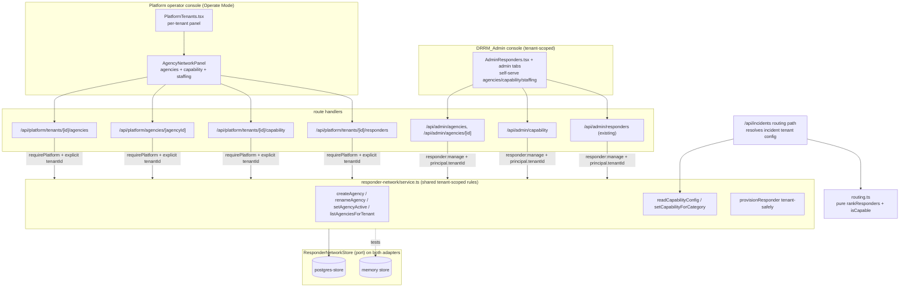

# Design Document: tenant-responder-network

## Overview

This feature connects a tenant's **responding organizations** and **responders** to its already-shipped
Office_Tree, and makes the category→agency capability that drives routing **configurable per tenant** instead
of hardcoded. Three slices ship together as one coherent management surface:

1. **Tenant-scoped agencies.** `public.agencies` stops being a flat global table and is **recreated** owned by
   exactly one Tenant (`tenant_id NOT NULL`), carrying a stable **Agency_Type** (`FIRE | POLICE | MEDICAL |
DRRM | OTHER`) and per-tenant case-insensitive uniqueness on `name`/`code`. Managers create, rename, and
   activate/deactivate a tenant's agencies.
2. **Tenant-safe responder provisioning** into a specific Office + optional Agency, with the office's tenant
   and the agency's tenant required to match the acting management scope.
3. **Per-tenant Capability_Config.** The hardcoded `CATEGORY_AGENCY_CAPABILITY` map becomes a per-tenant
   mapping from each Emergency_Category to a set of capable Agency_Types. The Routing_Engine reads that config
   plus a candidate's Agency_Type; the shipped **Default_Capability_Config** reproduces today's behavior
   exactly, so routing is unchanged out of the box.

Both authority tiers manage the same surface (OQ1 = BOTH): a **Platform_Operator** across any Tenant and a
Tenant's own **DRRM_Admin** bounded to its own Tenant. The two tiers stay fully isolated server-side (separate
tables, sessions, cookies); the shared tenant-scoped logic lives in one service, reached through two thin,
separately-authenticated handler entry points.

The design **extends the already-shipped platform spine** rather than inventing a new one:

```
route  →  handler (platform-auth OR responder-auth)  →  shared service fn  →  store (postgres | in-memory)
```

Everything new slots onto that spine exactly as `createTenant` / `handleCreateTenant` / `createTenantWithLgu`
and the tenant-office-management feature already do, reusing `requirePlatform`, `isSameOrigin`,
`errorResponse`, the `PlatformStore` port + its two implementations, the `23505 → 409` conflict mapping, and
the `ACCOUNT_CREATED` audit path. Frozen rules preserved by construction: one LGU per tenant (untouched), the
mesh payload + anonymous Tier-0 SOS (untouched — this surface is Tier 2 and never blocks SOS), Supabase as a
Postgres provider only (schema changes are a new SQL migration; no Supabase Auth), deny-by-default RBAC,
tenant isolation bounded in SQL, boundary validation, audit logging, and no coordinates in logs/URLs/errors.

### What already exists (grounding)

- **Routing engine** (`isCapable`, `rankResponders`, `bestSuggestion`, `RoutingCandidate`,
  `CATEGORY_AGENCY_CAPABILITY`) — `apps/web/src/lib/routing.ts`. Pure, deterministic, keyed today off a
  hardcoded agency-**code** map; `RoutingCandidate` carries `agencyCode`/`agencyName`, `role`, `base`.
- **Routing candidate source** (`listRoutingCandidates` joins `responders → offices`, `left join agencies`,
  projecting `a.code as agencyCode`) and the dispatcher routing path calling `rankResponders` —
  `apps/web/src/lib/incidents-store.ts`, `apps/web/src/lib/api/incidents-handlers.ts`.
- **Agencies schema** (global `agencies`: `name 2..64`, `code 2..12`, `active`; `agencies_name_lower_uniq`,
  `agencies_code_lower_uniq`; `responders.office_id NOT NULL`, `responders.agency_id` nullable
  `on delete set null`; the `aira_app` grant block + Data-API revokes) —
  `packages/db/supabase/migrations/20261022030655_auth_rbac.sql`.
- **Tenancy** (`public.tenants`, seed tenant `7e000000-0000-4000-8000-000000000001` "Cebu City DRRMO",
  `offices.tenant_id NOT NULL`, `offices_one_lgu_per_tenant`, the `aira_app` grant pattern) —
  `packages/db/supabase/migrations/20261022190000_tenants.sql`. A responder's `tenantId` is **derived via its
  office** (`o.tenant_id as "tenantId"` in `RESPONDER_COLUMNS`), not stored on `responders`.
- **Per-tenant uniqueness precedent** (drop global index → create `(tenant_id, lower(name))`) —
  `packages/db/supabase/migrations/20261022240000_office_name_per_tenant.sql` (the latest migration; the new
  file timestamps **after** it).
- **Platform spine**: `PlatformStore` port + domain types — `apps/web/src/lib/platform/types.ts`; service
  rules (`createTenant` rounds+validates, `23505 → conflict`; `createBarangayOffice`;
  `lguOfficeIdForTenant`) — `apps/web/src/lib/platform/service.ts`; SQL adapter — `postgres-store.ts`;
  in-memory adapter — `apps/web/tests/support/memory-platform-store.ts`.
- **Handlers + HTTP helpers**: `requirePlatform` (401), `isSameOrigin` (403 `forbidden_origin`),
  `errorResponse`, `NO_STORE_HEADERS`, `PRIVATE_CACHE_HEADERS`, `readJsonObject`, `isNonEmptyString`,
  `notifySafe` post-success hook — `apps/web/src/lib/api/platform-handlers.ts`,
  `apps/web/src/lib/api/http.ts`; dependency wiring — `apps/web/src/lib/api/deps.ts`. Routes live under
  `apps/web/app/api/platform/**`.
- **Responder-tier management** (the DRRM_Admin path): `createResponder` (officeId + nullable agencyId,
  one-time password, `ACCOUNT_CREATED` audit) — `apps/web/src/lib/auth/service.ts`; store insert +
  `listAgencies` — `apps/web/src/lib/auth/postgres-store.ts`; `responder:manage` + deny-by-default
  `ROLE_PERMISSIONS` + platform capability constants — `apps/web/src/lib/auth/rbac.ts`; `authenticate` +
  `requirePermission` — `apps/web/src/lib/api/session-guard.ts`; the admin roster/create/patch handlers —
  `apps/web/src/lib/api/admin-handlers.ts`.
- **UI**: per-tenant expandable panel pattern (`OfficeTreePanel` hung off `PlatformTenants`) —
  `apps/web/src/components/PlatformTenants.tsx`; confirm-gated responder UI with office/agency selects —
  `apps/web/src/components/AdminResponders.tsx`; primitives (`Button`, `Field`, `Input`, `Select`,
  `ConfirmDialog`, `Skeleton`, `useToast`, `cn`) — `@aira/ui/web`; copy — `packages/ui/src/i18n.ts` (`t()`,
  `AVAILABLE_LOCALES = ['en']`); the frozen category ids (`EmergencyCategoryId = 'SUNOG'|'MEDIKAL'|'KRIMEN'|
'BAHA'`) — `packages/ui/src/categories.ts`; tokens — `@aira/tailwind-config`; Lucide icons.

### Three resolved decisions (recorded)

- **OQ1 — BOTH tiers manage.** Platform_Operator (any Tenant) and DRRM_Admin (own Tenant only). Implemented as
  one shared tenant-scoped service reached by two authenticated handler entry points.
- **OQ2 — RECREATE agencies.** The migration drops and recreates `agencies` in its tenant-scoped shape; no
  pre-existing global agency rows are preserved; dangling `responders.agency_id` is reset to null.
- **OQ3 — TENANT/LGU-level presence.** No per-office agency-presence table. Agencies are owned at the Tenant
  level; responders are still placed in a specific Office and optionally affiliated with one Agency.

## Architecture



**Scope resolution is the only difference between the two entry points.** A Platform_Operator handler takes
the acting tenant scope from the **explicit `tenantId` in the route** (the operator is not tenant-bounded). A
DRRM_Admin handler takes the acting tenant scope from the **signed-in responder's own tenant**
(`principal.tenantId`, derived from its office). Both then call the _same_ service function, which treats the
acting tenant scope as the hard boundary for every read/write.

### Why extend the platform tier (not a new module)

Agency/capability/staffing management is tenant management — exactly the platform tier's remit (SECURITY.md
§12: no `incident:*`, no citizen/medical access) and exactly the DRRM_Admin's existing `responder:manage`
remit (SECURITY.md §4). Reusing the port, the two adapters, the guard helpers, the conflict mapping, and the
post-success `notifySafe` pattern inherits cross-tier isolation and header conventions with no new transport
(AGENTS.md rules 5, 9, 13, 15).

## Components and Interfaces

### Shared Agency_Type definition (single source of truth)

Agency_Type is a closed five-value taxonomy consumed by **both** the DB and the app (Routing_Engine +
`@aira/ui`). To satisfy R2.1/R2.6 (one shared definition; identifiers, not display text) it is defined **once
in `@aira/ui`** and re-exported where needed:

```ts
// packages/ui/src/agency-types.ts  (new, exported from @aira/ui barrel)
export const AGENCY_TYPES = ['FIRE', 'POLICE', 'MEDICAL', 'DRRM', 'OTHER'] as const;
export type AgencyType = (typeof AGENCY_TYPES)[number];
const AGENCY_TYPE_SET: ReadonlySet<string> = new Set(AGENCY_TYPES);
export function isAgencyType(value: unknown): value is AgencyType {
  return typeof value === 'string' && AGENCY_TYPE_SET.has(value);
}
```

- The **database** mirrors the _same five values_ as a `CHECK (agency_type in ('FIRE','POLICE','MEDICAL',
'DRRM','OTHER'))` (a Postgres enum would add migration friction for no benefit here; a CHECK keeps the taxonomy
  readable and matches the project's existing `kind in (...)`/`status in (...)` style). The SQL list and the
  `AGENCY_TYPES` array are the _same five tokens_; a unit test asserts they stay in lockstep.
- **Human labels** come only from `t()` (keys `agencyTypeFire`, `agencyTypePolice`, `agencyTypeMedical`,
  `agencyTypeDrrm`, `agencyTypeOther`) — never a hardcoded display string (R2.6, AGENTS.md rule 3).
- `EmergencyCategoryId` is reused as-is for the Capability_Config category key; the frozen set
  `{SUNOG, MEDIKAL, KRIMEN, BAHA}` already lives in `@aira/ui`.

### Route shapes (two tiers, isolated)

| Tier       | Method & path                                       | Handler                            | Purpose                                                  |
| ---------- | --------------------------------------------------- | ---------------------------------- | -------------------------------------------------------- |
| Operator   | `POST /api/platform/tenants/[id]/agencies`          | `handlePlatformCreateAgency`       | Create an agency for tenant `[id]` (R3.2).               |
| Operator   | `GET /api/platform/tenants/[id]/agencies`           | `handlePlatformListAgencies`       | List tenant `[id]`'s agencies (R3.1).                    |
| Operator   | `PATCH /api/platform/agencies/[agencyId]`           | `handlePlatformUpdateAgency`       | Rename and/or set `active` (R3.5/R3.6).                  |
| Operator   | `GET /api/platform/tenants/[id]/capability`         | `handlePlatformReadCapability`     | Read tenant `[id]`'s Capability_Config (R5.1).           |
| Operator   | `PATCH /api/platform/tenants/[id]/capability`       | `handlePlatformSetCapability`      | Replace one category's agency-type set (R5.2).           |
| Operator   | `POST /api/platform/tenants/[id]/responders`        | `handlePlatformProvisionResponder` | Staff a responder into tenant `[id]` (R4).               |
| DRRM_Admin | `POST /api/admin/agencies`                          | `handleAdminCreateAgency`          | Create an agency in the admin's own tenant (R3.2, R7.7). |
| DRRM_Admin | `GET /api/admin/agencies`                           | `handleAdminListAgencies`          | List the admin's own tenant's agencies (R3.1).           |
| DRRM_Admin | `PATCH /api/admin/agencies/[agencyId]`              | `handleAdminUpdateAgency`          | Rename / activate in-tenant (R3.5/R3.6, R7.4/R7.5).      |
| DRRM_Admin | `GET /api/admin/capability`                         | `handleAdminReadCapability`        | Read own tenant's Capability_Config (R5.1).              |
| DRRM_Admin | `PATCH /api/admin/capability`                       | `handleAdminSetCapability`         | Replace one category's set, own tenant (R5.2).           |
| DRRM_Admin | `POST /api/admin/responders` _(existing, extended)_ | `handleCreateResponder`            | Provision into own tenant, tenant-safely (R4).           |

**Rationale.** Operator routes carry the tenant id in the URL because the operator acts on an _explicit_
tenant. Agency edit/activate is `agencies/[agencyId]` because it targets a specific row whose `tenant_id` the
server re-derives (never trusting the URL for ownership). DRRM_Admin routes carry **no** tenant id — the
tenant is the admin's own and is read from the session, so a DRRM_Admin can never even name another tenant in
a URL. Capability has no sub-id (a tenant has exactly one config); the category travels in the body.

Every route follows the shipped wrapper exactly (`getAppDeps()` → 503, `await ctx.params`):

```ts
export const runtime = 'nodejs';
export const dynamic = 'force-dynamic';
export async function POST(request: Request, ctx: { params: Promise<{ id: string }> }) {
  const deps = getAppDeps();
  if (!deps) return errorResponse(503, 'service_unavailable');
  const { id } = await ctx.params;
  return handlePlatformCreateAgency(request, deps, id);
}
```

### Handlers (two thin entry points per action)

Each pair of handlers shares one service function; they differ only in authentication and in how they resolve
the acting tenant scope.

**Operator entry point** (in `platform-handlers.ts`), e.g. `handlePlatformCreateAgency(request, deps, tenantId)`:

1. `if (!isSameOrigin(request)) return errorResponse(403, 'forbidden_origin')` — before auth, on every
   mutation (R7.3).
2. `const ctx = await requirePlatform(request, deps); if ('response' in ctx) return ctx.response` — 401 for a
   missing/responder/citizen session (R7.1). A valid platform session is authorized for **any** tenant (R7.2).
3. `const body = await readJsonObject(request); if (!body) return errorResponse(400, 'invalid_json')`.
4. Call the shared service with `scope = { kind: 'operator', tenantId }`.
5. Map the discriminated result to the status table (below); `notifySafe` post-success hook carries only
   identity (never coordinates; this surface has none anyway).

**DRRM_Admin entry point** (in `admin-handlers.ts`), e.g. `handleAdminCreateAgency(request, deps)`:

1. `if (!isSameOrigin(request)) return errorResponse(403, 'forbidden_origin')` (R7.3).
2. `const context = await authenticate(request, deps); if (!context.ok) return context.response` — 401 (R7.1).
3. `const forbidden = requirePermission(context.principal, 'responder:manage'); if (forbidden) return forbidden`
   — 403 for a role without the permission (R7.1/R7.2, deny-by-default).
4. Call the **same** shared service with `scope = { kind: 'tenant', tenantId: context.principal.tenantId }`.
5. Identical result→status mapping.

Because the DRRM_Admin's `tenantId` is derived from its own office, a DRRM_Admin request can only ever act
inside its own tenant. The service additionally enforces this (defense-in-depth): any referenced office or
agency whose `tenant_id` differs from the acting scope is treated under the cross-tenant rules (R7.4/R7.5).

#### Status-code table (shared by both tiers)

| Outcome                                                       | HTTP | `error` id                                                                                |
| ------------------------------------------------------------- | ---- | ----------------------------------------------------------------------------------------- |
| Agency created                                                | 201  | — (`{ ok, agency }`)                                                                      |
| Agency renamed / active changed                               | 200  | — (`{ ok, agency }`)                                                                      |
| Capability read / updated                                     | 200  | — (`{ ok, capability }`)                                                                  |
| Responder provisioned                                         | 201  | — (`{ ok, responder, password }`)                                                         |
| Invalid JSON                                                  | 400  | `invalid_json`                                                                            |
| Name/code length out of range                                 | 400  | `invalid_agency` (R3.3)                                                                   |
| Missing/invalid Agency_Type                                   | 400  | `invalid_agency_type` (R2.4/R2.5)                                                         |
| Missing office id (provision)                                 | 400  | `invalid_responder` (R4.2)                                                                |
| Agency wrong tenant / inactive (provision)                    | 400  | `invalid_agency` (R4.6/R4.7)                                                              |
| Invalid category or agency-type in capability update          | 400  | `invalid_capability` (R5.7)                                                               |
| Unauthenticated                                               | 401  | `unauthenticated` (R7.1)                                                                  |
| Forbidden (no permission / DRRM_Admin cross-tenant known)     | 403  | `forbidden` (R7.2/R7.4) · `forbidden_origin` for same-origin failure (R7.3)               |
| Office belongs to another tenant (provision)                  | 403  | `forbidden` (R4.4)                                                                        |
| Tenant / agency / office not found (or not visible in-tenant) | 404  | `tenant_not_found` · `agency_not_found` · `office_not_found` (R3.7/R3.8, R4.3/R4.5, R7.5) |
| Name/code case-insensitive collision in tenant                | 409  | `agency_exists` (R3.4)                                                                    |

> **DRRM_Admin cross-tenant disambiguation (R7.4 vs R7.5).** A platform operator targeting a missing resource
> gets a plain `404`. A DRRM_Admin gets **403** when the resource exists but is known to belong to another
> tenant _only where the route exposes a resource id the admin could have guessed_ (agency edit/activate by id,
> responder office id). For reads/writes keyed solely by the admin's own tenant (capability, agency list), a
> foreign resource is simply **not visible** → `404` (R7.5). The service returns a discriminated
> `cross_tenant` vs `not_found` so the handler picks the right code per route.

### Service functions (`apps/web/src/lib/responder-network/service.ts`, new module)

Pure rules over the injected store + clock, mirroring `createTenant`/`createBarangayOffice`. The acting scope
is passed in explicitly so neither tier can widen it:

```ts
export type ActingScope = { readonly tenantId: string };

export type CreateAgencyResult =
  | { readonly status: 'ok'; readonly agency: AgencyRecord }
  | { readonly status: 'invalid' } // name/code length (R3.3)
  | { readonly status: 'invalid_type' } // agency_type not in taxonomy / missing (R2.4/R2.5)
  | { readonly status: 'tenant_not_found' } // target tenant absent (R3.7)
  | { readonly status: 'conflict' }; // per-tenant name/code collision (R3.4)

export async function createAgency(
  deps: ResponderNetworkDeps,
  scope: ActingScope,
  input: { readonly name: string; readonly code: string; readonly agencyType: string },
): Promise<CreateAgencyResult>;
```

Validation (fail before any write), reused across create/rename:

1. `const name = input.name.trim(); if (name.length < 2 || name.length > 64) return { status: 'invalid' }` (R3.3).
2. `const code = input.code.trim(); if (code.length < 2 || code.length > 12) return { status: 'invalid' }` (R3.3).
3. `if (!isAgencyType(input.agencyType)) return { status: 'invalid_type' }` — also catches a missing field,
   which arrives `undefined` (R2.4/R2.5). The generic error id never echoes the submitted value.
4. Delegate to `store.createAgency({ tenantId: scope.tenantId, name, code, agencyType })`; translate
   `23505 → { status: 'conflict' }` exactly like `createTenant` (R3.4). The store returns `'tenant_not_found'`
   as a typed outcome (R3.7).

`renameAgency` / `setAgencyActive` take an `agencyId`, first resolve the agency, and enforce scope: if the
agency's `tenant_id !== scope.tenantId` the service returns a `cross_tenant` outcome (the handler maps it per
the R7.4/R7.5 rule); a missing agency returns `not_found` (R3.8). Rename re-runs the name/code length +
`23505 → conflict` checks (R3.4). `setAgencyActive` only flips the boolean and never deletes a row (R3.6).

`provisionResponder(deps, scope, input)` composes the **existing** `createResponder` with tenant-safety
checks, so role assignment, the one-time password, and the `ACCOUNT_CREATED` audit stay on the proven path
(R4.1, R4.9):

1. `if (!input.officeId) return { status: 'invalid' }` (R4.2).
2. Resolve the office; absent → `office_not_found` (R4.3); `office.tenantId !== scope.tenantId` →
   `office_cross_tenant` → **403** (R4.4).
3. If an `agencyId` is supplied: resolve it; absent → `agency_not_found` → **404** (R4.5);
   `agency.tenantId !== office.tenantId` → `agency_cross_tenant` → **400** (R4.6); `!agency.active` →
   `agency_inactive` → **400** (R4.7).
4. No `agencyId` ⇒ create as a DRRM_Generalist with `agency_id = null` (R4.8).
5. Delegate to `createResponder(deps.auth, { ...input, agencyId })`; its result (one-time password,
   `ACCOUNT_CREATED` audit, `409` conflict) is surfaced unchanged.

`readCapabilityConfig(deps, scope)` returns the stored config, or the **Default_Capability_Config** when none
is stored (R5.3). `setCapabilityForCategory(deps, scope, category, agencyTypes)`:

1. `if (!isEmergencyCategoryId(category)) return { status: 'invalid' }` (R5.7).
2. `if (!agencyTypes.every(isAgencyType)) return { status: 'invalid' }` (R5.7).
3. **De-duplicate** the submitted set (`[...new Set(agencyTypes)]`) (R5.4).
4. Full-replace the stored set for that one category within the tenant; return the whole updated config
   (R5.4). An update identical to the current stored mapping persists no change and returns the current config
   (R5.5) — the store upsert is naturally idempotent, so this falls out for free.

### `PlatformStore` port additions (`apps/web/src/lib/platform/types.ts`)

The new persistence methods are added to the **same `PlatformStore` port** (both tiers' stores already reach
Postgres through it) so there is exactly one place to implement for Postgres and one for the in-memory harness.
New domain types:

```ts
import type { AgencyType } from '@aira/ui';
import type { EmergencyCategoryId } from '@aira/ui';

export interface AgencyRecord {
  readonly id: string;
  readonly tenantId: string;
  readonly name: string;
  readonly code: string;
  readonly agencyType: AgencyType;
  readonly active: boolean;
}

/** One row per (tenant, category); the value is the set of capable agency types. */
export type CapabilityConfig = Readonly<Record<EmergencyCategoryId, readonly AgencyType[]>>;

export interface CreateAgencyStoreInput {
  readonly tenantId: string;
  readonly name: string;
  readonly code: string;
  readonly agencyType: AgencyType;
}

export interface PlatformStore {
  // ...existing members unchanged...

  /** Insert one agency; throws `{ code: '23505' }` on a per-tenant name/code collision;
   *  returns 'tenant_not_found' when the tenant is absent. */
  createAgency(
    input: CreateAgencyStoreInput,
  ): Promise<
    | { readonly status: 'ok'; readonly agency: AgencyRecord }
    | { readonly status: 'tenant_not_found' }
  >;
  listAgenciesForTenant(tenantId: string): Promise<readonly AgencyRecord[]>;
  findAgencyById(agencyId: string): Promise<AgencyRecord | null>;
  renameAgency(
    agencyId: string,
    patch: { readonly name?: string; readonly code?: string },
  ): Promise<AgencyRecord | null>; // throws { code: '23505' } on collision
  setAgencyActive(agencyId: string, active: boolean): Promise<AgencyRecord | null>;

  findOfficeTenantId(officeId: string): Promise<string | null>;

  /** Full Capability_Config for a tenant, or null when none is stored (service falls back to default). */
  readCapabilityConfig(tenantId: string): Promise<CapabilityConfig | null>;
  /** Upsert the full set for exactly one category within a tenant; returns the resulting full config. */
  setCapabilityForCategory(
    tenantId: string,
    category: EmergencyCategoryId,
    agencyTypes: readonly AgencyType[],
  ): Promise<CapabilityConfig>;
}
```

Both adapters MUST implement these behavior-compatibly (R9.8): the Postgres adapter in `postgres-store.ts`,
the in-memory adapter in `tests/support/memory-platform-store.ts`. `provisionResponder` reuses the existing
`AuthStore.createResponder`; the only new store method it needs is `findOfficeTenantId` (office→tenant) and
`findAgencyById` (agency tenant/active check), both added above.

#### Postgres implementation notes

- `createAgency` inserts `(tenant_id, name, code, agency_type, active = true)`; a present-tenant check
  (`select 1 from public.tenants where id = $1`) distinguishes `tenant_not_found` from the FK error; the
  per-tenant unique indexes raise `23505` → conflict.
- `readCapabilityConfig` reads rows from the new `tenant_capability_config` table into a
  `Record<category, agencyType[]>`; a tenant with zero rows returns `null` so the service applies the default.
- `setCapabilityForCategory` runs in a `withTransaction`: delete the tenant's rows for that one category, then
  insert one row per de-duplicated agency type, then re-read and return the full config (full-replace, R5.4).

#### In-memory implementation notes

Mirror each method over `Map`s (`agencies: Map<id, AgencyRecord>`, `capability: Map<tenantId,
Map<category, Set<AgencyType>>>`), enforcing the _same_ per-tenant case-insensitive name/code uniqueness by
throwing `Object.assign(new Error('dup'), { code: '23505' })`, and returning the identical discriminated
outcomes (R9.8). This keeps the entire API testable with no database (TESTING.md §4.3).

### Routing engine changes (`apps/web/src/lib/routing.ts`)

The pure functions stop reading the module-level `CATEGORY_AGENCY_CAPABILITY` constant and instead take a
resolved `CapabilityConfig` plus each candidate's `agencyType`. `RoutingCandidate` swaps `agencyCode: string |
null` for `agencyType: AgencyType | null` (null = DRRM_Generalist). New signatures:

```ts
export function isCapable(
  category: EmergencyCategoryId,
  agencyType: AgencyType | null,
  config: CapabilityConfig,
): boolean {
  if (agencyType === null) return true; // DRRM_Generalist: capable of anything (R6.2)
  const capable = config[category] ?? []; // unknown/empty set ⇒ no non-generalist is capable
  return capable.includes(agencyType); // present-but-unresolved type ⇒ false (R6.6)
}

export function rankResponders(
  category: EmergencyCategoryId,
  incident: GeoPoint,
  candidates: readonly RoutingCandidate[],
  config: CapabilityConfig,
): readonly RoutingSuggestion[];
```

- **`DEFAULT_CAPABILITY_CONFIG`** is exported from routing (or `@aira/ui`) as
  `{ SUNOG: ['FIRE'], MEDIKAL: ['MEDICAL'], KRIMEN: ['POLICE'], BAHA: [] }` (R5.8). Under this config,
  `isCapable` reproduces the legacy map **exactly** for every (category, type) pair, because the seed mapping
  BFP→FIRE / EMS→MEDICAL / PNP→POLICE / BAHA→∅ is a one-to-one relabel of the old codes (R6.3, R9.7).
- **Ordering is untouched** (R6.4): (a) capable before non-capable; (b) within a band, known base distance
  before unknown, nearer before farther; (c) `callsign.localeCompare` as the stable final tiebreak. Only the
  capability _predicate_ changes; the `.sort` comparator is copied verbatim.
- **Role filter untouched** (R6.5): only `role === 'RESPONDER'` candidates are ranked.
- **Generalist vs unresolved type** (R6.2/R6.6): `agencyType === null` ⇒ always capable; a non-null
  `agencyType` not present in `config[category]` (including a type that no longer exists in the taxonomy, or an
  empty set) ⇒ non-capable, with no throw.
- **Purity/determinism preserved** (R6.7): the function reads only its arguments, mutates nothing, and
  `config` is treated as readonly — so two runs over identical inputs yield an identical ordering.

**Dispatcher routing path** (`incidents-handlers.ts` + `incidents-store.ts`): `listRoutingCandidates`
projects `a.agency_type as "agencyType"` instead of `a.code as "agencyCode"`; the handler resolves the
**incident tenant's** config via `readCapabilityConfig(incidentTenantId)` (falling back to
`DEFAULT_CAPABILITY_CONFIG`) and passes it into `rankResponders`. The incident's tenant is the office's tenant
(same office→tenant join already used), so no schema change on `incidents` is needed (R6.1).

### Client + UI

**Operator surface** — a new `AgencyNetworkPanel` hung off the existing per-tenant expandable panel in
`PlatformTenants.tsx` (same `officesFor`-style toggle), with three sub-sections:

- **Agencies**: a list (name · code · Agency_Type label via `t()` · active badge), an "Add agency" form
  (`Field`+`Input` for name/code, `Select` of Agency_Types), per-row rename (inline `Input`) and an
  activate/deactivate toggle. Deactivate is gated behind `ConfirmDialog` (R8.5/R8.6).
- **Capability editor**: one row per Emergency_Category (`SUNOG/MEDIKAL/KRIMEN/BAHA`), each with five
  `Checkbox` toggles (one per Agency_Type). Toggling submits a full-replace `PATCH …/capability` for that
  category; the empty set is allowed (DRRM_Generalists then lead, R5.9). First-load shows a `Skeleton`.
- **Responder staffing**: reuses the `AdminResponders` create-form shape (email, optional callsign, role,
  office `Select` scoped to the tenant, agency `Select` scoped to the tenant) posting to
  `…/tenants/[id]/responders`; the one-time password renders exactly once.

**DRRM_Admin surface** — `AdminResponders.tsx` and the admin tabbed surface gain the same agencies + capability
editors, but tenant-scoped to the session (no tenant picker). The existing responder create-form already has
office/agency selects; its agency `Select` now lists the tenant's agencies from `GET /api/admin/agencies`.

**Operate Mode (R8)**: Lucide icons via `@aira/ui/web` (e.g. `Building2`, `ShieldCheck`, `Plus`, `ShieldOff`),
tokens from `@aira/tailwind-config`, every string via `t()` (no hardcoded copy, no emoji — R8.1); layout-shaped
`Skeleton` on first load (R8.2); every outcome through `useToast()` with coordinate-free messages (R8.3/R8.4);
destructive actions behind `ConfirmDialog` (R8.5/R8.6); a failed/slow/offline call surfaces an
`useToast()` "unavailable" state and never touches the Tier-0 SOS path (R8.7). On failure the affected data is
left unchanged (the panel refetches only on success — R8.4/R8.6).

**Client** (`apps/web/src/lib/platform-client.ts` for the operator surface, a small `admin-client` helper for
the DRRM_Admin surface): parse-at-the-boundary helpers mirroring `parseOfficeTree` —
`loadAgencies(tenantId?)`, `createAgency(...)`, `renameAgency(...)`, `setAgencyActive(...)`,
`loadCapability(tenantId?)`, `setCapability(category, agencyTypes)`, `provisionResponder(...)`. All use
`credentials: 'same-origin'` + `cache: 'no-store'`. No coordinates are involved anywhere in this feature.

**New i18n keys** (added to the English dictionary in `packages/ui/src/i18n.ts`): `agencyTypeFire`,
`agencyTypePolice`, `agencyTypeMedical`, `agencyTypeDrrm`, `agencyTypeOther`, `agencyNetworkTitle`,
`agenciesTitle`, `addAgency`, `agencyNameLabel`, `agencyCodeLabel`, `agencyTypeLabel`, `agencyActiveLabel`,
`renameAgency`, `deactivateAgency`, `deactivateAgencyTitle`, `deactivateAgencyBody`, `activateAgency`,
`agencyCreated`, `agencyCreateFailed`, `agencyRenamed`, `agencyUpdateFailed`, `capabilityTitle`,
`capabilityCategory`, `capabilitySaved`, `capabilitySaveFailed`, `capabilityUnavailable`,
`staffResponderTitle`. No component hardcodes display text (AGENTS.md rule 3).

## Data Models

### Migration (new file, after `20261022240000`)

A single new timestamp-prefixed migration — e.g. `20261022250000_tenant_responder_network.sql` — that leaves
every earlier migration byte-for-byte unchanged (R1.6/R9.5, AGENTS.md rule 15). It **recreates** `agencies`
(OQ2/R9.1), resets dangling responder affiliations (R9.3), and adds the capability table.

```sql
-- 1) Recreate agencies, tenant-scoped, with Agency_Type (OQ2 / R1 / R9).
--    No pre-existing global agency rows are preserved. First detach responders so the
--    drop is clean, then recreate and re-seed, then re-point seed responders.
alter table public.responders drop constraint if exists responders_agency_id_fkey;
update public.responders set agency_id = null;              -- dangling → DRRM_Generalist (R9.3)

drop table if exists public.agencies cascade;               -- drop the global table (OQ2 / R9.1)

create table public.agencies (
  id          uuid primary key default gen_random_uuid(),
  tenant_id   uuid not null references public.tenants (id) on delete restrict,  -- R1.1/R1.2/R1.3
  name        text not null check (char_length(name) between 2 and 64),
  code        text not null check (char_length(code) between 2 and 12),
  agency_type text not null check (agency_type in ('FIRE','POLICE','MEDICAL','DRRM','OTHER')), -- R1.4/R1.5
  active      boolean not null default true,
  created_at  timestamptz not null default now(),
  updated_at  timestamptz not null default now()
);

-- Per-tenant case-insensitive uniqueness (replaces the dropped global indexes, R1.7–R1.11).
create unique index agencies_name_lower_per_tenant_uniq on public.agencies (tenant_id, lower(name));
create unique index agencies_code_lower_per_tenant_uniq on public.agencies (tenant_id, lower(code));
create index agencies_tenant_id_idx on public.agencies (tenant_id);

create trigger agencies_touch_updated_at
  before update on public.agencies for each row execute function public.touch_updated_at();

-- Re-seed BFP/PNP/EMS/DRRM for the seed tenant with their types (R2.2/R2.3/R9.2); any
-- other seed org would be OTHER (R2.3). Codes stay as display-independent identifiers.
insert into public.agencies (tenant_id, name, code, agency_type) values
  ('7e000000-0000-4000-8000-000000000001', 'Bureau of Fire Protection', 'BFP', 'FIRE'),
  ('7e000000-0000-4000-8000-000000000001', 'Philippine National Police', 'PNP', 'POLICE'),
  ('7e000000-0000-4000-8000-000000000001', 'Emergency Medical Services', 'EMS', 'MEDICAL'),
  ('7e000000-0000-4000-8000-000000000001', 'City DRRM Rescue', 'DRRM', 'DRRM');

-- Re-attach the FK (nullable, on delete set null — unchanged semantics, R4.8/R9.3/R9.6).
alter table public.responders
  add constraint responders_agency_id_fkey
  foreign key (agency_id) references public.agencies (id) on delete set null;

-- 2) Per-tenant Capability_Config: a normalized (tenant, category, agency_type) table.
--    Normalized (not JSONB) because the update semantics are "replace the SET for ONE
--    category" (R5.4) — a delete-then-insert per category is exact, and uniqueness is
--    enforceable. A tenant with zero rows ⇒ the app applies Default_Capability_Config (R5.3).
create table public.tenant_capability_config (
  tenant_id   uuid not null references public.tenants (id) on delete cascade,
  category    text not null check (category in ('SUNOG','MEDIKAL','KRIMEN','BAHA')), -- frozen set
  agency_type text not null check (agency_type in ('FIRE','POLICE','MEDICAL','DRRM','OTHER')),
  primary key (tenant_id, category, agency_type)
);
create index tenant_capability_config_tenant_cat_idx
  on public.tenant_capability_config (tenant_id, category);

-- 3) Least privilege: same deny-by-default pattern as every other business table (R1.12).
do $$
begin
  foreach ... in array array['agencies','tenant_capability_config'] loop
    -- revoke all from anon/authenticated/service_role when those roles exist
  end loop;
end; $$;
grant select, insert, update, delete on public.agencies to aira_app;             -- update covers rename/active
grant select, insert, update, delete on public.tenant_capability_config to aira_app; -- delete covers full-replace
```

> **Frozen-migration rule.** This is a _new_ file strictly after `20261022240000_office_name_per_tenant.sql`;
> none of the existing migrations are edited (R1.6/R9.5, AGENTS.md rule 15). On a fresh/seeded DB the
> `cascade` drop + recreate is clean because there is no production agency data to protect (OQ2/R9.1). The
> `responders.agency_id = null` reset guarantees every responder is a valid DRRM_Generalist after the
> migration (R9.3/R9.6), and the re-seeded BFP/PNP/EMS/DRRM rows keep seed/fixture affiliations resolvable
> (R9.4). `incidents.office_id` and the office tree are untouched.

### Capability_Config shape returned to the UI / routing

```jsonc
{
  "SUNOG": ["FIRE"],
  "MEDIKAL": ["MEDICAL"],
  "KRIMEN": ["POLICE"],
  "BAHA": [], // empty ⇒ only DRRM_Generalists are capable (R5.9)
}
```

Always a total map over the frozen category set: the service fills any category absent from storage with its
default (so a partially-configured tenant still returns all four keys), and `readCapabilityConfig` returning
`null` means "no rows at all" ⇒ full `DEFAULT_CAPABILITY_CONFIG` (R5.3).

### API contracts (request / response)

**`POST /api/platform/tenants/{id}/agencies`** (and `POST /api/admin/agencies`, body only, tenant from session)
Request: `{ "name": string(2..64), "code": string(2..12), "agencyType": AgencyType }`
Responses: `201 { ok, agency }` · `400 invalid_agency|invalid_agency_type|invalid_json` · `401` · `403` ·
`404 tenant_not_found` · `409 agency_exists` · `503`.

**`PATCH /api/platform/agencies/{agencyId}`** (and `/api/admin/agencies/{agencyId}`)
Request: `{ "name"?: string(2..64), "code"?: string(2..12), "active"?: boolean }`
Responses: `200 { ok, agency }` · `400 invalid_agency` · `401` · `403 forbidden` · `404 agency_not_found` ·
`409 agency_exists` · `503`.

**`GET …/capability`** → `200 { ok, capability }` (private, short-TTL cache) · `401` · `403` ·
`404 tenant_not_found` (operator, unknown tenant) · `503`.
**`PATCH …/capability`** Request: `{ "category": EmergencyCategoryId, "agencyTypes": AgencyType[] }` →
`200 { ok, capability }` · `400 invalid_capability` · `401` · `403` · `404 tenant_not_found` · `503`.

**`POST …/responders`** Request: `{ "email", "callsign"?, "role", "officeId", "agencyId"? , "mustChangePassword"? }`
→ `201 { ok, responder, password }` · `400 invalid_responder|invalid_agency|invalid_email|weak_password` ·
`401` · `403 forbidden` (office another tenant) · `404 office_not_found|agency_not_found` · `409 email_taken` ·
`503`.

## Correctness Properties

_A property is a characteristic or behavior that should hold true across all valid executions of a
system — essentially, a formal statement about what the system should do. Properties serve as the bridge
between human-readable specifications and machine-verifiable correctness guarantees._

These properties target the pure/testable cores: the Routing_Engine (`isCapable`, `rankResponders`), the
Agency_Type taxonomy, and the service rules over the in-memory store. Each is implemented as a single
fast-check property at ≥100 runs. Non-input-varying criteria (migration structure, grants, endpoint wiring,
authN/same-origin plumbing, seed values, UI rendering) are covered by the integration/smoke/example tests in
the Testing Strategy, not here.

### Property 1: Agency_Type validation accepts exactly the taxonomy

_For any_ string value, a create/rename/capability request accepts the value as an Agency_Type **if and only
if** it is one of `{FIRE, POLICE, MEDICAL, DRRM, OTHER}`; any other value (including a missing/`undefined`
field) is rejected with a generic `invalid_agency_type` error, no agency row is inserted or modified, and the
error identifier never echoes the submitted value.

**Validates: Requirements 1.4, 1.5, 2.4, 2.5**

### Property 2: Per-tenant case-insensitive name/code uniqueness

_For any_ two agencies and any field in `{name, code}`, two distinct Tenants may each hold an agency whose
field value is equal (in any letter case), whereas a create or rename that would give one Tenant two agencies
with a case-insensitively equal `name` (or `code`) is rejected with `409 agency_exists`, inserts/modifies no
row, and leaves the pre-existing agency unchanged.

**Validates: Requirements 1.7, 1.8, 1.9, 1.10, 3.4**

### Property 3: Agency create/rename/activate round-trip + length validation

_For any_ submitted agency, a create succeeds **iff** the trimmed `name` length is in 2..64 and the trimmed
`code` length is in 2..12 (and the type is valid and the tenant exists); on success exactly one row is added
whose persisted `tenantId`, trimmed `name`, trimmed `code`, and `agencyType` equal the submitted values, a
rename reads back the submitted trimmed name/code, and `setAgencyActive(b)` reads back `active === b` while
retaining the row (and a repeated identical set is idempotent). An out-of-range length yields `400
invalid_agency` with no write.

**Validates: Requirements 3.2, 3.3, 3.5, 3.6**

### Property 4: Responder staffing is tenant-safe

_For any_ acting tenant scope, target Office, and optional Agency, `provisionResponder` creates exactly one
Responder **if and only if** the Office exists and belongs to the acting scope's Tenant, and (when an Agency
is supplied) the Agency exists, belongs to the Office's Tenant, and is active; in every other case it refuses
(office-another-tenant → 403, agency-another-tenant/inactive → 400, unknown office/agency → 404) and creates
no Responder. When no Agency is supplied, the created Responder has `agency_id` null (a DRRM_Generalist).

**Validates: Requirements 4.2, 4.3, 4.4, 4.6, 4.7, 4.8**

### Property 5: Capability update is a de-duplicated full replace (idempotent)

_For any_ Tenant, frozen Emergency_Category, and submitted list of Agency_Types (possibly containing
duplicates), after `setCapabilityForCategory` the stored set for that category equals the set of **distinct**
submitted Agency_Types exactly (a full replace, not a merge), the other three categories are unchanged, a
read-after-write returns that same set, and applying the identical update again leaves the config unchanged
(idempotence: `f(f(x)) = f(x)`).

**Validates: Requirements 5.2, 5.4, 5.5**

### Property 6: Capability read is total with default fallback

_For any_ Tenant, reading the Capability_Config returns a total mapping whose keys are exactly the frozen set
`{SUNOG, MEDIKAL, KRIMEN, BAHA}`; a Tenant with no stored configuration reads back exactly the
`Default_Capability_Config` (`SUNOG→{FIRE}`, `MEDIKAL→{MEDICAL}`, `KRIMEN→{POLICE}`, `BAHA→∅`).

**Validates: Requirements 5.1, 5.3, 9.7**

### Property 7: Capability update validation

_For any_ submitted category string and list of Agency_Types, the update is accepted **if and only if** the
category is a member of the frozen set `{SUNOG, MEDIKAL, KRIMEN, BAHA}` **and** every submitted Agency_Type is
in the taxonomy; otherwise it is rejected with `400 invalid_capability` and the stored Capability_Config is
left unchanged.

**Validates: Requirements 5.7**

### Property 8: Capability determination (generalist, default-equals-legacy, unresolved)

_For any_ Capability_Config, Emergency_Category, and candidate Agency_Type, `isCapable` holds that: a
candidate with no Agency_Type (null, a DRRM_Generalist) is capable of every category regardless of config;
under `Default_Capability_Config` the capable/non-capable result for every (category, Agency_Type) pair equals
the result the previous hardcoded `CATEGORY_AGENCY_CAPABILITY` map produced (BFP↔FIRE, EMS↔MEDICAL,
PNP↔POLICE, BAHA↔∅); and a non-null Agency_Type absent from `config[category]` (including an empty set or a
type outside the taxonomy) is non-capable, with the computation never throwing.

**Validates: Requirements 5.9, 6.2, 6.3, 6.6, 9.6**

### Property 9: Ranking precedence and determinism

_For any_ Emergency_Category, incident position, Capability_Config, and candidate set, the result of
`rankResponders` respects, pairwise, the precedence: (a) capable candidates before non-capable; (b) within the
same capability band, a candidate with a known base distance before one with an unknown base distance, and
among known distances the nearer great-circle distance before the farther; (c) a stable case-sensitive
`callsign.localeCompare` as the final tiebreak. Running the function twice over identical inputs yields an
identical ordering, and the inputs are not mutated.

**Validates: Requirements 6.4, 6.7**

### Property 10: Only RESPONDER candidates are suggested

_For any_ candidate set, every suggestion returned by `rankResponders` has `role === 'RESPONDER'`, and no
candidate with role `DISPATCHER` or `ADMIN` appears in the results.

**Validates: Requirements 6.5**

### Property 11: Tenant isolation on every management action

_For any_ acting scope and referenced Agency/Responder/Office/Capability_Config, a Platform_Operator scope may
act on resources in any Tenant, whereas a DRRM_Admin scope may act **only** on resources in its own Tenant: a
reference to a resource known to belong to another Tenant is refused with `403` and a reference not visible
within the admin's own Tenant is refused with `404`; in either refusal no resource is read or modified.

**Validates: Requirements 7.4, 7.5, 7.7**

### Property 12: No coordinate ever leaves a management action

_For any_ management request and its response (success or error) and any audit entry it writes, the serialized
output contains no coordinate value; management responses and error identifiers for this feature carry only
identity/status fields, never a latitude/longitude.

**Validates: Requirements 7.6, 4.9**

### Property 13: Store adapter equivalence

_For any_ sequence of agency/responder/capability create, read, rename, and activation operations with
identical inputs, the in-memory `PlatformStore` and the Postgres `PlatformStore` return the same discriminated
success/failure outcome and the same persisted result (including `23505 → conflict`, `tenant_not_found`, and
`cross_tenant`/`not_found` distinctions).

**Validates: Requirements 9.8**

## Error Handling

- **Boundary validation first.** Every handler parses the body with `readJsonObject` (malformed →
  `400 invalid_json`), then validates shapes with `isNonEmptyString`/`isAgencyType`/`isEmergencyCategoryId`
  before any service call. The service re-validates lengths and taxonomy membership so a direct caller cannot
  bypass the handler (defense-in-depth).
- **Discriminated results, total mapping.** Service functions return discriminated unions (never throw for
  expected outcomes); handlers map each variant to exactly one status via the status-code table. The only
  thrown error the service catches is the store's `{ code: '23505' }`, mapped to `409 agency_exists` exactly
  as `createTenant` maps it.
- **Generic, value-free error identifiers.** Every 4xx returns `{ ok: false, error: '<id>' }` with a stable
  identifier that never echoes the submitted value (R2.4/R2.5) and never contains a coordinate (R7.6) — there
  are no coordinates anywhere in this feature's payloads.
- **AuthN/AuthZ/CSRF ordering.** Mutations run `isSameOrigin` → auth (`requirePlatform` or
  `authenticate`+`requirePermission`) → validation, so an unauthenticated or cross-origin request never
  reaches the store (R7.1/R7.2/R7.3).
- **Tenant-isolation failures** are returned as `403` (known cross-tenant) or `404` (not visible) per the
  disambiguation rule, with no read/write side effect (R7.4/R7.5).
- **503 when the DB is absent.** Routes return `503 service_unavailable` when `getAppDeps()` is null, matching
  every shipped route.
- **Fail-soft post-success hooks.** Any `notifySafe` notification runs after the committed mutation and can
  never change its result (mirrors `handleCreateTenant`).
- **Routing never throws.** `isCapable`/`rankResponders` handle an unresolved Agency_Type and an empty
  capability set by treating the candidate as non-capable, completing ranking without error (R6.6).
- **UI honest degradation.** A failed/timed-out/offline call surfaces an `useToast()` "unavailable" state,
  leaves the affected data unchanged, and never blocks the Tier-0 anonymous mesh SOS path (R8.4/R8.7).

## Testing Strategy

Dual approach: property-based tests for the pure/universal cores, plus unit, integration, and component tests
for examples, edge cases, wiring, and UI. `pnpm check` (typecheck + tests) must be green before the feature
is done (AGENTS.md rule 6; TESTING.md).

**Property-based tests (fast-check, already the repo's PBT library; ≥100 runs each).** Properties 1–13 above.
Each test is tagged with a comment referencing its design property, in the format:

```
// Feature: tenant-responder-network, Property 8: Capability determination (generalist, default-equals-legacy, unresolved)
```

- Properties 1–7, 11, 13 run against the **service + in-memory `PlatformStore`** (no DB — TESTING.md §4.3),
  using fast-check generators for tenant ids, names/codes (including boundary lengths and case variants),
  Agency_Types (in- and out-of-taxonomy strings), category strings, and agency-type lists with duplicates.
- Properties 8–10 run against the **pure routing functions** with generators for `CapabilityConfig`,
  `EmergencyCategoryId`, `AgencyType | null`, candidate arrays (mixed roles, known/unknown bases, duplicate
  callsigns), and incident positions. Property 8 asserts equivalence to a local re-statement of the legacy
  `CATEGORY_AGENCY_CAPABILITY` semantics (model-based). Property 9 deep-freezes inputs to prove immutability.
- Property 12 asserts, over generated management responses/errors, that no coordinate-shaped number pair is
  ever serialized.
- Property 13 (store-adapter equivalence) is model-based: a shared contract suite replays identical operation
  sequences against the in-memory store (always) and the Postgres store (when a DB is configured in CI),
  asserting identical discriminated outcomes and persisted records.

**Unit tests (example / edge).** The Agency_Type↔SQL taxonomy lockstep (R2.1); `DEFAULT_CAPABILITY_CONFIG`
value (R5.8); seed-row types BFP/PNP/EMS/DRRM→types + OTHER (R2.2/R2.3/R9.2); unknown-tenant create → 404
(R3.7); unknown-agency rename/activate → 404 (R3.8); missing office id → 400 (R4.2); unknown office → 404
(R4.3); inactive agency → 400 (R4.7); the happy-path provision returns a one-time password + `ACCOUNT_CREATED`
audit (R4.1/R4.9).

**Integration tests (handlers over the in-memory store + fakes, both tiers).** Endpoint existence and the full
status table for each operator and DRRM_Admin route (R3.1); **cross-tier isolation** (a platform session is
rejected by an `/api/admin/*` route and a responder session by an `/api/platform/*` route, 401); **operator
cross-tenant allowed** vs **DRRM_Admin cross-tenant rejected** (R7.2/R7.4/R7.5); unauthenticated → 401 with the
store untouched (R7.1); cross-origin mutation → 403 `forbidden_origin` with no write (R7.3); non-manager role →
403 (R7.2); unauthorized capability update leaves config unchanged (R5.6); the dispatcher routing path resolves
the incident tenant's config and passes it to `rankResponders`.

**Component tests (jsdom, map-free).** `AgencyNetworkPanel` and the DRRM_Admin agency/capability editors:
first-load `Skeleton` (R8.2); success/failure `useToast()` with data unchanged on failure (R8.3/R8.4);
deactivate gated behind `ConfirmDialog`, confirm mutates, cancel aborts with no network call (R8.5/R8.6);
offline/timeout → "unavailable" toast (R8.7); all labels resolve through `t()` and icons come from
`@aira/ui/web` (R8.1/R2.6). These reuse the existing jsdom setup; no map is mounted in this feature's UI.

**Schema / smoke tests.** The new migration sorts strictly after `20261022240000` and edits no earlier file
(R1.6/R9.5); the recreated `agencies` table has `tenant_id NOT NULL`, the `agency_type` CHECK, and the
per-tenant `name`/`code` unique indexes while the global indexes are gone (R1.11/R9.1); `aira_app` holds the
least-privilege grants and the Data-API roles are revoked (R1.12); after migration responders keep `office_id`
and dangling `agency_id` is null (R9.3), and seed/fixture affiliations resolve (R9.4).

**No DB required for the default test run.** Every property/unit/integration/component test above runs against
the in-memory store and fakes; the Postgres-backed equivalence/schema checks run only when a database is
configured.

## Impact on docs

- **AGENTS.md** — add a `2026-10-22` change-log entry: tenant-scoped responder network (recreated
  tenant-owned `agencies` with Agency_Type + per-tenant uniqueness; per-tenant Capability_Config; tenant-safe
  responder staffing; routing keyed off config+type with default-equals-legacy; BOTH tiers manage via one
  shared service with two authenticated entry points). Note the frozen rules preserved (mesh payload, Tier-0,
  one-LGU, Supabase-as-Postgres) and the new migration after `20261022240000`.
- **SECURITY.md** — record tenant isolation for the responder network and the **two-tier authority** model
  (Platform_Operator cross-tenant; DRRM_Admin own-tenant via `responder:manage`), the deny-by-default +
  SQL-bounded scope, and the no-coordinate-in-logs/URLs rule applied to the new endpoints.
- **PRODUCT.md** — note that category→agency capability is now per-tenant configurable and agencies are
  tenant-owned, with routing behavior unchanged under the shipped default.
- **DESIGN.md** — note the new Operate Mode surfaces (operator `AgencyNetworkPanel`; DRRM_Admin agency +
  capability editors) following the skeleton/toast/ConfirmDialog/Lucide/token rules.
