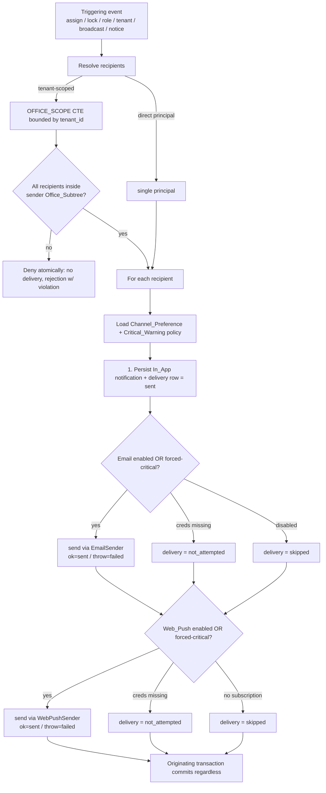

# Design Document

## Overview

This design turns the two-part overhaul in the requirements into a concrete, codebase-grounded plan for `apps/web`. It delivers:

1. A **theme-token CSS-variable refactor** of `packages/tailwind-config/index.js` plus a client theme runtime (provider, toggle, pre-paint script) so AIRA_Web can render light or dark without recompiling color literals (R1, R2).
2. A **single shared `App_Shell`** with a shared `NavLink`, consolidating the hand-rolled `AdminHeader`, `PlatformHeader`, and the inline `Dashboard.tsx` header into one coherent chrome, and collapsing the four flat admin routes into one deep-linkable tabbed surface (R3, R4, R5).
3. **Profile, Settings, and a Notification Center** common features on every authenticated tier (R6, R7, R8).
4. A **three-channel notification system** — In_App (persisted), Email (Gmail SMTP), Web_Push (VAPID) — sent synchronously within the originating request with fail-soft semantics, covering responder, platform, civilian-broadcast, and system-notice events, bounded by the existing tenant/office-subtree isolation (R9–R16).
5. **New accessible primitives** (Textarea, Checkbox, Radio, Switch), `Field` error auto-wiring, and **toast/confirm/loading polish** across the known gaps (R17–R20).
6. **Documentation updates** flagged for the task phase (R21), all under TDD with a green `pnpm check` (R22).

The design strictly reuses the repo's established seams: the `service + store(port) + runtime(wiring)` triad used by `auth`, `platform`, and `citizen`; the `AppDeps` dependency container built in `apps/web/src/lib/api/deps.ts`; the `*-handlers.ts` + `app/api/**/route.ts` handler pattern; the `OFFICE_SCOPE` recursive CTE bounded by `tenant_id` from `incidents-store.ts`; and the `@aira/ui/web` primitive library with `t()` i18n. No Supabase Auth, no background queue, no new realtime infrastructure.

### Research summary (key findings grounding the design)

- **Theme tokens**: colors live only as raw hex in the Tailwind preset `theme.extend.colors` (`ink/surface/raised/line/fg/muted`, `emergency.*`, `status.*` including notification tones `success/error/info`). `globals.css` hard-codes `color-scheme: dark` in `@layer base`; `tailwind.config.ts` has no `darkMode` key. Utility class names in use: `bg-ink`, `bg-surface`, `bg-raised`, `border-line`, `text-fg`, `text-muted`, `text-status-*`, `border-l-status-*`, `border-emergency-sunog`, `bg-emergency-sunog`. The refactor must keep every one of these class names resolving unchanged (R1.2).
- **Three isolated tiers**: `responders` (principal `AuthenticatedPrincipal` with `responderId/role/tenantId/officeId`, cookie via `SESSION_COOKIE`), `platform_admins` (`PlatformPrincipal` with `adminId/email`, no role, cookie `PLATFORM_SESSION_COOKIE`), `citizens` (`CitizenPrincipal` with `citizenId`, cookie `aira_citizen_session`). Each is keyed by its own UUID with **no shared users FK** — the notification data model mirrors this with a `(tier, principal_id)` pair (R9.4, R9.5).
- **RBAC**: `rbac.ts` exposes `PERMISSIONS`, `ROLE_PERMISSIONS` keyed by `PrincipalRole = Role | 'CITIZEN'`, and `can/canAny/assertPermission/landingFor`. Platform operators are **not** in the `Role` union, so `system-notice` cannot be a responder permission — it is modeled as a platform-tier capability check (see §Components).
- **Tenant isolation**: `incidents-store.ts` defines `OFFICE_SCOPE` — a `with recursive scope` CTE seeded by `offices where id = $1`, following `parent_id` links **only within the same `tenant_id`**. `listForOffice` and `isInOfficeScope` use it. All civilian-broadcast targeting reuses this exact bounding (R13.4, R16.1).
- **Citizen area gap**: `citizens` currently has **no** office/tenant membership column. Civilian-broadcast targeting (R13.4) therefore requires a new area linkage on citizens (`tenant_id` + `office_id`), added via migration, so a broadcast can resolve recipients through `OFFICE_SCOPE`.
- **Handler deps**: `getAppDeps()` eagerly constructs `auth/citizen/medical/tracking/platform` deps + rate limiters and returns `null` when `DATABASE_URL` is absent (routes answer 503). `getMedicalDeps` reads `MEDICAL_ENCRYPTION_KEY`. The notification service is added to `AppDeps` the same way.
- **Event hook points** (verified call sites): incident assign → `handleAssignIncident` (`incidents-handlers.ts`); account lock → `login` failure path in `auth/service.ts` (`ACCOUNT_LOCKED`); role-change/deactivate/unlock → `updateResponder` in `auth/service.ts` (`roleChanged`/`deactivated`, and `patch.unlock`); tenant onboard/suspend → `handleCreateTenant`/`handleSetTenantStatus` (`platform-handlers.ts`).
- **Primitives**: `Field` renders `label/hint/error` but does **not** set `aria-describedby`/`aria-invalid` on the child input (R20.2 gap). `ToastProvider` (`role="status"`, `aria-live="polite"`, 5s, bottom-right) and `ConfirmDialog` (Radix AlertDialog) exist. There is no `Textarea/Checkbox/Radio/Switch`. `Skeleton` exists; only `Dashboard.tsx` has layout skeletons (`components/loading.tsx`); there are **no** route-level `loading.tsx` files anywhere.

## Architecture

### Layering (unchanged seam, extended)

```
app/**/route.ts  ──calls──▶  *-handlers.ts  ──reads──▶  AppDeps (deps.ts)
                                                          │
                                                          ├─ auth / platform / citizen / incidents (existing)
                                                          └─ notifications  ◀── NEW
                                                                 │ service.ts (pure rules over injected store + channels + clock)
                                                                 │ types.ts   (NotificationStore port + domain types + channel sender ports)
                                                                 │ runtime.ts (postgres store + real Email/WebPush senders, env-driven)
                                                                 └─ postgres-store.ts / memory-store.ts (test seam)
```

Server React components read the principal (existing layouts) and pass data to **client islands** (`'use client'`) for interactive pieces (notification bell, settings forms, theme toggle). The App_Shell is a server component that renders a client header island for the interactive controls.

### Notification send flow (synchronous, fail-soft)

A notification-triggering event calls `notify(...)` on the NotificationService inside the originating request. The service persists the In_App copy first, then dispatches Email and Web_Push in a fixed order, recording one delivery outcome per channel. No channel failure throws out of `notify`.



### Theme runtime flow

```mermaid
sequenceDiagram
    participant Head as document &lt;head&gt;
    participant LS as localStorage
    participant MM as matchMedia
    participant TP as ThemeProvider (client)
    participant Root as html[data-theme]
    Head->>LS: inline pre-paint script reads "aira-theme"
    Head->>MM: if system/unset, read prefers-color-scheme
    Head->>Root: set data-theme before first paint (no FOUC) (R2.6)
    TP->>LS: hydrate preference (light/dark/system)
    TP->>MM: subscribe when preference=system (R2.5)
    TP->>Root: on change, update data-theme within 120ms, no reload (R2.2)
```

## Components and Interfaces

### 1. Theme tokens and runtime (R1, R2)

**Decision — `data-theme` attribute over `class`.** Both satisfy R1.5/R2.2. We choose `data-theme="light|dark"` on `<html>` because (a) it expresses a single exclusive state rather than relying on absence/presence of a `.dark` class, making the pre-paint script and SSR default unambiguous; (b) it keeps Tailwind utilities untouched — we do **not** use Tailwind's `dark:` variant anywhere, so we set `darkMode: ['class', '[data-theme="dark"]']` only to register the strategy, but tokens resolve purely through CSS variables cascading from `:root` / `[data-theme]` selectors. This keeps R1.2 intact: `bg-ink` still means `background-color: rgb(var(--color-ink) / <alpha-value>)` regardless of theme.

**Preset refactor.** Each hex becomes a CSS-variable reference using the `rgb(var(--token) / <alpha-value>)` form so Tailwind's opacity modifiers (`bg-ink/85`, `placeholder:text-muted/70`, `bg-ink/85` in ConfirmDialog overlay) keep working:

```js
// packages/tailwind-config/index.js (shape)
const withAlpha = (v) => `rgb(var(${v}) / <alpha-value>)`;
colors: {
  ink: withAlpha('--color-ink'),
  surface: withAlpha('--color-surface'),
  raised: withAlpha('--color-raised'),
  line: withAlpha('--color-line'),
  fg: withAlpha('--color-fg'),
  muted: withAlpha('--color-muted'),
  emergency: { sunog: withAlpha('--color-emergency-sunog'), /* medikal/krimen/baha */ },
  status: { queued: withAlpha('--color-status-queued'), /* dispatched/enroute/onscene/resolved */
            success: withAlpha('--color-status-success'), error: withAlpha('--color-status-error'),
            info: withAlpha('--color-status-info') },
}
```

Variables are defined as space-separated RGB channels (so `<alpha-value>` works) in `globals.css`:

```css
@layer base {
  :root,
  [data-theme='dark'] {
    /* dark = exact current hex, channelized (R1.4, R1.6) */
    --color-ink: 11 15 20; /* #0B0F14 */
    --color-surface: 18 24 31; /* #12181F */
    --color-raised: 26 34 44; /* #1A222C */
    --color-line: 42 52 65; /* #2A3441 */
    --color-fg: 242 245 248; /* #F2F5F8 */
    --color-muted: 147 161 176; /* #93A1B0 */
    --color-emergency-sunog: 255 59 31; /* ... all emergency + status tones */
  }
  [data-theme='light'] {
    /* light values chosen for WCAG AA (R1.7) */
    --color-ink: 247 249 251; /* near-white app bg */
    --color-fg: 11 15 20; /* dark text on light */
    --color-muted: 71 85 102; /* AA on light surfaces */
    /* emergency/status tones re-tuned so fg-on-surface + UI boundaries meet 4.5:1 / 3:1 */
  }
}
```

The fixed `color-scheme: dark` is replaced by `color-scheme` bound per theme (`:root { color-scheme: dark } [data-theme='light'] { color-scheme: light }`) (R1.5).

**Pre-paint script** (inlined in `app/layout.tsx` `<head>` via `next/script` `strategy="beforeInteractive"` or a raw `<script dangerouslySetInnerHTML>`), executed before paint (R2.6):

```ts
// resolves preference → concrete theme, sets data-theme synchronously
(function () {
  try {
    var p = localStorage.getItem('aira-theme') || 'system';
    var sys = matchMedia('(prefers-color-scheme: dark)').matches ? 'dark' : 'light';
    document.documentElement.setAttribute('data-theme', p === 'system' ? sys : p);
  } catch (_) {
    document.documentElement.setAttribute('data-theme', 'dark');
  }
})();
```

**ThemeProvider / useTheme** (new client module in `@aira/ui/web`):

```ts
export type ThemePreference = 'light' | 'dark' | 'system';
export type ResolvedTheme = 'light' | 'dark';

export interface ThemeContextValue {
  readonly preference: ThemePreference; // persisted choice
  readonly resolved: ResolvedTheme; // concrete theme currently applied
  setPreference(next: ThemePreference): void; // writes localStorage + data-theme < 120ms (R2.2, R2.3)
}

export function ThemeProvider(props: { children: ReactNode }): ReactElement;
export function useTheme(): ThemeContextValue;

export interface ThemeToggleProps {
  readonly className?: string;
}
export function ThemeToggle(props: ThemeToggleProps): ReactElement; // light/dark/system control (R2.1)
```

`ThemeProvider` reads the initial `data-theme` already set by the pre-paint script (no flash), hydrates `preference` from `localStorage` (default `'system'`, R2.4), and when `preference === 'system'` subscribes to `matchMedia('(prefers-color-scheme: dark)')` change events to re-resolve without reload (R2.5). `setPreference` persists to `localStorage['aira-theme']` and updates `data-theme`.

### 2. App_Shell + NavLink + IA consolidation (R3, R4, R5)

**NavLink** (new in `@aira/ui/web`, replaces copy-pasted `usePathname` logic in both headers):

```ts
export type NavMatch = 'exact' | 'nested';

export interface NavLinkProps {
  readonly href: string;
  readonly label: string;
  readonly match?: NavMatch; // default 'exact'
  readonly icon?: ReactNode;
}
// active when (match==='exact' && pathname===href) ||
//            (match==='nested' && (pathname===href || pathname.startsWith(href + '/')))  (R3.4, R3.5)
// active → aria-current="page" + active visual; else omit aria-current (R3.6)
export function NavLink(props: NavLinkProps): ReactElement;
```

**App_Shell** (new; one definition used by console, admin, platform, and account/profile/settings). It is a server component rendering a client `AppShellHeader` island so the bell, theme toggle, and profile menu are interactive:

```ts
export interface NavEntry {
  readonly href: string;
  readonly label: string;
  readonly match?: NavMatch;
  readonly permission?: Permission; // responder-tier gate via can() (R3.7)
  readonly platformOnly?: boolean; // platform-tier entries (no responder Role)
}

export interface ShellIdentity {
  readonly tier: NotificationTier; // 'responders' | 'platform_admins' | 'citizens'
  readonly displayName: string; // callsign/email local-part
  readonly roleLabel?: string; // responder role label; omitted for platform/citizen
}

export interface AppShellProps {
  readonly identity: ShellIdentity;
  readonly navEntries: readonly NavEntry[]; // already filtered by caller/tier
  readonly children: ReactNode;
}
export function AppShell(props: AppShellProps): ReactElement;
```

The header region always exposes the Notification bell + Profile + Settings entry points in the same place across every tier (R3.9, R8.1). Navigation entries are filtered before render: responder entries by `can(role, entry.permission)` (R3.7); the entry set is derived from the tier so RESPONDER/DISPATCHER (console) and ADMIN (admin) get different menus (R3.8). Platform entries use `platformOnly` (operators carry no `Role`). `AdminHeader`, `PlatformHeader`, and the inline `Dashboard.tsx` header are deleted; zero usages remain (R3.2, R3.3).

**Admin tabbed surface** (R4). `/admin`, `/admin/dashboards`, `/admin/audit` all render one `AdminSurface` inside the App_Shell content frame; the selected tab is derived from the URL so each stays a deep-linkable bookmark (R4.1, R4.2, R4.8). `/admin/overview` becomes a redirect to the surviving map+queue view (R4.3). The live map + queue is extracted into a single shared `IncidentConsole` component reused by `/console` and admin, eliminating the duplicate in `AdminOverview.tsx` (R4.4). Tabs are gated per permission: accounts→`responder:manage`, metrics→`metrics:read`, audit→`audit:read`; a tab (and its content) is omitted when the permission is absent (R4.6, R4.7); initial tab = deep-linked tab if present else the first permitted tab (R4.8); if the principal holds none, a not-authorized indication renders (R4.9, reusing `Forbidden.tsx`). Tab switching updates content while keeping the same shell/header instance (R4.5).

**Account/password relocation** (R5). The chrome-less `/account/password` is moved into the Profile/Settings area under App_Shell; its page renders inside the shell with the principal's authorized NavLinks, reachable by any entry path (R5.1–R5.4). The existing `ChangePasswordForm` is reused inside the Profile page.

### 3. Profile, Settings, Notification Center (R6, R7, R8)

Per-tier routes (all under App_Shell), e.g. `/console/profile`, `/console/settings`, `/admin/profile`, `/admin/settings`, `/platform/profile`, `/platform/settings`, and citizen equivalents. Each page is a server component that loads the principal + preferences and renders client islands.

```ts
// Profile (R6)
export interface ProfileViewProps {
  readonly email: string; // read-only (R6.2)
  readonly tier: NotificationTier;
  readonly editable?: { readonly displayName: string; readonly callsign: string | null }; // responders only (R6.3)
  readonly canChangePassword: boolean; // can(role,'account:change-password') (R6.6)
}
```

Profile submit persists via a tier-appropriate route and shows a success Toast (R6.4); invalid submits render the error wired to the field via the upgraded `Field` (R6.5). Password change is embedded where `account:change-password` holds (R6.6).

```ts
// Settings (R7)
export interface SettingsViewProps {
  readonly theme: ThemeContextValue; // Theme control from R2 (R7.2)
  readonly preferences: ChannelPreferenceView; // per-channel in_app/email/web_push (R7.3)
  readonly pushState: 'unsupported' | 'default' | 'granted' | 'denied';
}
export interface ChannelPreferenceView {
  readonly inApp: boolean; // locked true for critical (R14.5)
  readonly email: boolean;
  readonly webPush: boolean;
}
```

Changing a preference persists for the principal and confirms with a Toast (R7.4). Enabling Web_Push requests browser permission and registers a server-stored `Push_Subscription` bound to the principal (R7.5); if permission is denied, Web_Push stays disabled and an explanatory message shows (R7.6).

```ts
// Notification Center (R8) — client island in the shell header
export interface NotificationCenterProps {
  readonly initialUnread: number;
  readonly initialItems: readonly NotificationView[];
}
export interface NotificationView {
  readonly id: string;
  readonly type: string;
  readonly title: string;
  readonly body: string;
  readonly read: boolean;
  readonly createdAt: string; // ISO UTC
}
```

**Unread-count data flow — decision: lightweight polling.** The bell island fetches `GET /api/notifications?unread=1` (count + recent list) on mount and polls on a fixed interval (default 30s) with `visibilitychange` pause, plus an immediate refetch after mark-read actions. This is the simplest robust option, reuses the existing `useIncidents`-style polling idiom already in the codebase, needs no websockets/SSE or new infra, and tolerates fail-soft channels (In_App is always authoritative). Opening a notification marks it read and decrements the count (R8.4); mark-all-read zeroes it (R8.5). The list is reverse-chronological and scoped strictly to the signed-in principal's `(tier, principal_id)` (R8.2, R8.6). The unread count is exposed to assistive tech via `aria-live` + an `aria-label` on the badge (R20.5).

### 4. NotificationService, store, and channels (R9–R16)

New module `apps/web/src/lib/notifications/` mirroring the `platform` triad.

```ts
// types.ts — domain + ports
export type NotificationTier = 'responders' | 'platform_admins' | 'citizens';
export type NotificationChannel = 'in_app' | 'email' | 'web_push';
export type DeliveryOutcome = 'sent' | 'failed' | 'skipped' | 'not_attempted';

/** The tier-scoped recipient key — mirrors how each tier is keyed, no shared users FK (R9.4,R9.5). */
export interface PrincipalRef {
  readonly tier: NotificationTier;
  readonly principalId: string; // responders.id | platform_admins.id | citizens.id
}

export interface NotificationPayload {
  readonly type: string; // e.g. 'incident.assigned', 'account.locked'
  readonly data: Readonly<Record<string, unknown>>; // structured context (R9.7)
  readonly title: string; // rendered presentation (R9.7)
  readonly body: string;
}

export interface NotificationRecord {
  readonly id: string;
  readonly recipient: PrincipalRef;
  readonly type: string;
  readonly payload: NotificationPayload;
  readonly read: boolean;
  readonly critical: boolean;
  readonly createdAt: number; // UTC ms (R9.1)
}

export interface DeliveryRecord {
  readonly notificationId: string;
  readonly channel: NotificationChannel;
  readonly outcome: DeliveryOutcome;
  readonly overridden: boolean; // critical override of an opt-out (R14.4)
  readonly recordedAt: number; // UTC (R9.2)
}

export interface ChannelPreference {
  readonly recipient: PrincipalRef;
  readonly inApp: boolean; // cannot be false for critical (R14.5)
  readonly email: boolean;
  readonly webPush: boolean;
}

export interface PushSubscriptionRecord {
  readonly id: string;
  readonly recipient: PrincipalRef; // bound to exactly one tier principal (R9.4)
  readonly endpoint: string;
  readonly p256dh: string;
  readonly auth: string;
  readonly createdAt: number;
}

/** Channel sender ports — the testability seam for Email/Web_Push. */
export interface EmailMessage {
  readonly to: string;
  readonly subject: string;
  readonly text: string;
  readonly html?: string;
}
export interface EmailSender {
  send(message: EmailMessage): Promise<void>;
} // throws on failure (→ 'failed')

export interface WebPushMessage {
  readonly subscription: PushSubscriptionRecord;
  readonly payload: NotificationPayload;
}
export interface WebPushSender {
  send(message: WebPushMessage): Promise<void>;
} // throws on failure (→ 'failed')

/** Persistence port. Memory + Postgres implementations (test seam, R22). */
export interface NotificationStore {
  createNotification(input: Omit<NotificationRecord, 'id' | 'read'>): Promise<NotificationRecord>;
  recordDelivery(input: Omit<DeliveryRecord, 'recordedAt'> & { at: number }): Promise<void>;
  listForRecipient(recipient: PrincipalRef, limit: number): Promise<readonly NotificationRecord[]>;
  countUnread(recipient: PrincipalRef): Promise<number>;
  markRead(recipient: PrincipalRef, notificationId: string): Promise<void>;
  markAllRead(recipient: PrincipalRef): Promise<void>;

  getPreference(recipient: PrincipalRef): Promise<ChannelPreference>; // defaults all-enabled when absent
  setPreference(pref: ChannelPreference): Promise<void>;

  saveSubscription(
    sub: Omit<PushSubscriptionRecord, 'id' | 'createdAt'> & { at: number },
  ): Promise<void>;
  deleteSubscription(recipient: PrincipalRef, endpoint: string): Promise<void>;
  listSubscriptions(recipient: PrincipalRef): Promise<readonly PushSubscriptionRecord[]>;

  /** Recipient resolvers for broadcast/notice targeting. */
  resolveCitizensInOfficeScope(
    tenantId: string,
    rootOfficeId: string,
  ): Promise<readonly PrincipalRef[]>; // OFFICE_SCOPE (R13.4,R16.1)
  isOfficeInScope(tenantId: string, rootOfficeId: string, targetOfficeId: string): Promise<boolean>; // targeting guard (R13.5,R16.2)
  listAllPrincipals(): Promise<readonly PrincipalRef[]>; // system-notice fan-out (R15.3)
  listPlatformAdmins(): Promise<readonly PrincipalRef[]>; // platform events (R12)

  recordBroadcastAudit(entry: BroadcastAudit): Promise<void>; // R13.7
  recordSystemNoticeAudit(entry: SystemNoticeAudit): Promise<void>; // R15.6
}

export interface BroadcastAudit {
  readonly senderId: string;
  readonly senderRole: Role;
  readonly tenantId: string;
  readonly granularity: 'tenant' | 'barangay';
  readonly targetOfficeId: string | null;
  readonly recipientCount: number;
  readonly outcome: 'accepted' | 'denied';
  readonly violation: string | null;
  readonly at: number;
}
export interface SystemNoticeAudit {
  readonly senderId: string;
  readonly at: number;
}
```

```ts
// service.ts — pure rules over injected store + channels + clock
export interface NotificationServiceDeps {
  readonly store: NotificationStore;
  readonly email: EmailSender | null; // null when SMTP_* absent → channel not_attempted (R10.7)
  readonly webPush: WebPushSender | null; // null when VAPID_* absent → channel not_attempted (R10.7)
  readonly now: () => number;
  readonly emailAddressFor: (ref: PrincipalRef) => Promise<string | null>;
}

/** The single fixed channel order (In_App first). */
export const CHANNEL_ORDER: readonly NotificationChannel[] = ['in_app', 'email', 'web_push'];

/**
 * The ONE documented, system-wide policy constant (R14.3). Not per-send overridable.
 * true  → a Critical_Warning forces Email + Web_Push even if the recipient opted out.
 * false → critical forces only In_App; Email/Web_Push still honor opt-out.
 */
export const CRITICAL_FORCES_ALL_CHANNELS = true; // documented default

/** Core synchronous, fail-soft dispatch to a single recipient. Never throws (R10). */
export async function notifyOne(
  deps: NotificationServiceDeps,
  recipient: PrincipalRef,
  payload: NotificationPayload,
  options: { readonly critical: boolean },
): Promise<void>;

/** Fan-out helper; resolves recipients, enforces isolation, then notifyOne each. */
export async function notifyMany(
  deps: NotificationServiceDeps,
  recipients: readonly PrincipalRef[],
  payload: NotificationPayload,
  options: { readonly critical: boolean },
): Promise<void>;
```

`notifyOne` algorithm (R10, R14):

1. Persist the In_App notification + delivery `sent` **first** (R10.2, R10.8). In_App is always delivered; for a critical warning the In_App opt-out is already impossible (R14.2, R14.5).
2. Load `ChannelPreference`. For Email then Web_Push in `CHANNEL_ORDER`:
   - credential/sender absent → record `not_attempted`, continue (R10.7).
   - channel disabled and not (critical && `CRITICAL_FORCES_ALL_CHANNELS`) → record `skipped` (R14.1).
   - otherwise attempt send inside `try/catch`: success → `sent`; thrown/failed → `failed` (R10.3, R10.4). If this was a forced override of an opt-out, set `overridden: true` (R14.4).
3. Exactly one delivery row per channel per notification (R10.8). The function returns normally even if Email/Web_Push threw, so the originating transaction commits (R10.3–R10.5, R10.8).

**Civilian broadcast** (R13) — new `broadcast-handlers.ts` + `app/api/broadcasts/route.ts`:

- Authorize server-side with a new `civilian-broadcast` permission via `can()` (DISPATCHER + ADMIN) (R13.1); non-holders get 403 and no delivery (R13.2).
- Target either whole-tenant (root = principal's LGU office) or a single barangay within the subtree; reject any other granularity (R13.3).
- Resolve recipients with `resolveCitizensInOfficeScope(tenantId, rootOfficeId)` using `OFFICE_SCOPE` (R13.4). Before sending, validate the target office is in scope via `isOfficeInScope`; if the target is outside the sender's subtree, deny **atomically** — no partial delivery — and return the violation (R13.5, R16.2).
- On accept, `notifyMany` with per-recipient preferences subject to R14 (R13.6), then `recordBroadcastAudit` with sender id/role, tenant, granularity, UTC, resolved count, outcome, and any rejected cross-subtree targeting (R13.7).

**System notice** (R15) — new `system-notice-handlers.ts` + `app/api/system-notices/route.ts`:

- Authorized only for a Platform_Tier principal (platform capability check; responders/citizens denied with no delivery) (R15.1, R15.2). Because platform operators have no `Role`, the check is `authenticatePlatform(...) !== null` combined with a named capability constant `PLATFORM_CAN_SYSTEM_NOTICE` documented in `rbac.ts` as the platform-tier counterpart (see §RBAC wiring).
- Address every principal across all three tiers via `listAllPrincipals()` (R15.3); deliver per preference subject to R14 (R15.4). Sending grants the operator **no** citizen/incident read access — the handler only writes notifications (R15.5, R16.3). Record sender id + UTC (R15.6).

**RBAC wiring** (R3.7, R4.6, R13.1, R15.1):

- Add `'civilian-broadcast'` to `PERMISSIONS`; grant to `DISPATCHER` and `ADMIN` in `ROLE_PERMISSIONS`.
- `system-notice` is **not** a responder permission (platform operators are outside the `Role` union). Represent it as a platform-tier capability: a documented constant `PLATFORM_CAN_SYSTEM_NOTICE = true` in `rbac.ts` plus the server guard `authenticatePlatform`. This keeps separation of duties explicit and avoids forcing a platform "role" into the responder RBAC table.

**Event hook points** (where `notify*` is called; all inside the existing request, fail-soft):

- Incident assign → in `handleAssignIncident` after a successful `assign` outcome: `notifyOne({tier:'responders', principalId: assignedResponderId}, 'incident.assigned', {critical:false})` (R11.1).
- Account lock → in `auth/service.ts` login failure path when `ACCOUNT_LOCKED`; unlock/role/deactivate → in `updateResponder` using the already-computed `roleChanged`/`deactivated` and `patch.unlock` (R11.2). These notify the affected responder only (R11.4).
- Tenant onboard → in `handleCreateTenant` after success: `notifyMany(listPlatformAdmins(), 'tenant.onboarded', {critical:false})`; suspend → in `handleSetTenantStatus` when status becomes `suspended` (R12.1, R12.2). Platform notifications carry no incident/citizen data (R12.4).

`getAppDeps()` gains `notifications: getNotificationDeps()`; `getNotificationDeps()` (runtime.ts) builds the postgres store and constructs `email`/`webPush` senders only when their env vars are present (else `null`).

### 5. Accessible primitives + Field wiring (R20)

New primitives in `@aira/ui/web/ui`, sharing the `CONTROL` class and visible focus ring (R20.3), all copy via `t()` (R20.6):

```ts
export interface TextareaProps extends TextareaHTMLAttributes<HTMLTextAreaElement> {}
export function Textarea(props: TextareaProps): ReactElement;

export interface CheckboxProps extends Omit<InputHTMLAttributes<HTMLInputElement>, 'type'> {
  readonly label?: string;
}
export function Checkbox(props: CheckboxProps): ReactElement;

export interface RadioProps extends Omit<InputHTMLAttributes<HTMLInputElement>, 'type'> {
  readonly label: string;
}
export function Radio(props: RadioProps): ReactElement;

export interface SwitchProps {
  readonly checked: boolean;
  readonly onCheckedChange: (v: boolean) => void;
  readonly label?: string;
  readonly disabled?: boolean;
}
export function Switch(props: SwitchProps): ReactElement; // role="switch", aria-checked, keyboard operable
```

**Field upgrade** (R20.2): `Field` clones its child control to inject `aria-describedby` (pointing at `${id}-hint` and/or `${id}-error`) and `aria-invalid={Boolean(error)}`, so AT announces the error. Backwards compatible — existing `Field` usages keep working; the control is wired automatically when it accepts those props.

### 6. Toast / confirm / loading polish (R17, R18, R19)

Exact call sites (grounded in current code):

- **Toasts to add**: platform logout (`PlatformHeader.signOut` → migrates into App_Shell header; add success Toast closing the silent gap, R17.3); console logout (`SignOutButton` → add success Toast, R17.4). All new/existing transaction toasts route through `t()` (R17.5) and use the existing `aria-live` ToastProvider (R17.6). Generic success/error toasts on create/update/delete flows (R17.1, R17.2).
- **Confirm dialogs to add** (via existing `ConfirmDialog`): suspend-tenant (destructive tone, R18.1); incident status transition incl. RESOLVED (R18.2); unlock-account, activate-tenant, logout (R18.3); civilian-broadcast send and system-notice send, each summarizing the audience (R18.4). Cancel aborts with no state change (R18.5). Existing confirmations on deactivate/role-change/revoke-sessions/unit-assign are preserved (R18.6).
- **Loading** (R19): add route-level `loading.tsx` for each async App Router segment (console, admin tabs, platform, platform/map, track, profile, settings) rendering layout-shaped skeletons (R19.1, R19.2, R19.5); add `PlatformMapSkeleton` and `CitizenTrackingSkeleton` to `components/loading.tsx` (R19.3). Failures reuse the existing console `LoadError` pattern with a retry control (R19.4).

## Data Models

New SQL migration(s) in `packages/db/supabase/migrations` (source of truth; no Supabase Auth — R9.6). Timestamps are `timestamptz` recorded via `now()` (UTC, R9.1/R9.2). Enums are Postgres enums. The tier discriminator is a `text` check over the three tier table names; the principal id is a bare UUID with **no** cross-tier FK (R9.4, R9.5).

```sql
create type notification_tier    as enum ('responders', 'platform_admins', 'citizens');
create type notification_channel as enum ('in_app', 'email', 'web_push');
create type delivery_outcome     as enum ('sent', 'failed', 'skipped', 'not_attempted');

-- Notifications: one row per recipient principal (R9.1, R9.3, R9.7)
create table public.notifications (
  id             uuid primary key default gen_random_uuid(),
  recipient_tier notification_tier not null,
  recipient_id   uuid not null,                 -- tier-scoped id; NO cross-tier FK (R9.5)
  type           text not null check (char_length(type) between 1 and 64),
  payload        jsonb not null,                -- { type, data, title, body } (R9.7)
  critical       boolean not null default false,
  read           boolean not null default false,-- initial unread (R9.3)
  created_at     timestamptz not null default now()  -- UTC (R9.1)
);
create index notifications_recipient_idx on public.notifications (recipient_tier, recipient_id, created_at desc);
create index notifications_unread_idx on public.notifications (recipient_tier, recipient_id) where read = false;

-- Per-channel delivery outcomes (R9.2, R10.8, R14.4)
create table public.notification_deliveries (
  notification_id uuid not null references public.notifications (id) on delete cascade,
  channel         notification_channel not null,
  outcome         delivery_outcome not null,
  overridden      boolean not null default false,  -- critical override of opt-out (R14.4)
  recorded_at     timestamptz not null default now(),
  primary key (notification_id, channel)           -- exactly one outcome per channel (R10.8)
);

-- Per-principal channel preferences (R7.3, R9.5, R14.5)
create table public.channel_preferences (
  recipient_tier notification_tier not null,
  recipient_id   uuid not null,
  in_app         boolean not null default true,   -- app enforces true-for-critical (R14.5)
  email          boolean not null default true,
  web_push       boolean not null default false,
  updated_at     timestamptz not null default now(),
  primary key (recipient_tier, recipient_id)
);

-- Server-stored browser push subscriptions (R7.5, R9.4)
create table public.push_subscriptions (
  id             uuid primary key default gen_random_uuid(),
  recipient_tier notification_tier not null,
  recipient_id   uuid not null,
  endpoint       text not null,
  p256dh         text not null,
  auth           text not null,
  created_at     timestamptz not null default now(),
  unique (recipient_tier, recipient_id, endpoint)
);

-- Civilian broadcast audit (R13.7)
create table public.civilian_broadcasts (
  id              uuid primary key default gen_random_uuid(),
  sender_id       uuid not null,                 -- responders.id (sender)
  sender_role     text not null check (sender_role in ('DISPATCHER','ADMIN')),
  tenant_id       uuid not null references public.tenants (id) on delete cascade,
  granularity     text not null check (granularity in ('tenant','barangay')),
  target_office_id uuid references public.offices (id) on delete set null,
  recipient_count integer not null check (recipient_count >= 0),
  outcome         text not null check (outcome in ('accepted','denied')),
  violation       text,                          -- cross-subtree targeting rejected (R13.5)
  created_at      timestamptz not null default now()
);

-- System notice audit (R15.6)
create table public.system_notices (
  id         uuid primary key default gen_random_uuid(),
  sender_id  uuid not null,                      -- platform_admins.id
  created_at timestamptz not null default now()
);

-- Citizen area membership — NEW: needed for OFFICE_SCOPE broadcast targeting (R13.4).
-- citizens currently has no tenant/office linkage. Nullable (anonymous device accounts
-- may have none); only citizens with a resolved area are targetable.
alter table public.citizens
  add column tenant_id uuid references public.tenants (id) on delete set null,
  add column office_id uuid references public.offices (id) on delete set null;
create index citizens_area_idx on public.citizens (tenant_id, office_id) where office_id is not null;
```

Least-privilege grants mirror existing migrations (`revoke all` from `anon/authenticated/service_role`; `grant select/insert/update[/delete]` to `aira_app`). TS domain types are the interfaces in §Components (`NotificationRecord`, `DeliveryRecord`, `ChannelPreference`, `PushSubscriptionRecord`, `PrincipalRef`, enums).

## Correctness Properties

_A property is a characteristic or behavior that should hold true across all valid executions of a system — essentially, a formal statement about what the system should do. Properties serve as the bridge between human-readable specifications and machine-verifiable correctness guarantees._

The notification core (`notifyOne`/`notifyMany`), the preference/forced-critical policy, the `NavLink` active-state computation, and the theme-preference resolver are **pure logic with input-dependent behavior over a large input space** — PBT applies to these. UI rendering (App_Shell, Settings, loading skeletons), SQL migrations (schema/DDL), and the Email/Web_Push transports themselves (side-effect I/O verified with injected fakes) are **not** PBT targets and are covered by component/integration/example tests in the Testing Strategy.

### Property 1: Fixed channel order with In_App first and exactly one outcome per channel

_For all_ recipients, payloads, preference combinations, and channel-sender success/failure patterns, `notifyOne` SHALL record the In_App delivery before any Email or Web_Push delivery, SHALL produce exactly one delivery outcome per attempted channel, and SHALL process channels in the order In_App → Email → Web_Push.

**Validates: Requirements 10.2, 10.8**

### Property 2: Fail-soft — a channel failure never throws out of dispatch

_For all_ recipients and payloads, if the Email sender and/or the Web_Push sender throws, `notifyOne` SHALL still return normally and SHALL retain the persisted In_App copy, recording `failed` for the throwing channel(s).

**Validates: Requirements 10.3, 10.4, 10.5, 10.8**

### Property 3: Missing credential yields not_attempted, not an error

_For all_ payloads, when a channel's sender is absent (its credentials are not configured), `notifyOne` SHALL record that channel's outcome as `not_attempted` and SHALL continue without raising.

**Validates: Requirements 10.6, 10.7**

### Property 4: Preference honored for routine, In_App forced for critical

_For all_ recipients and preference combinations, a non-critical notification SHALL be delivered only on channels the recipient enabled and `skipped` on disabled channels; and _for all_ critical warnings, the In_App copy SHALL be delivered regardless of preference.

**Validates: Requirements 14.1, 14.2, 14.5**

### Property 5: Forced-critical policy is uniform and records overrides

_For all_ critical warnings and recipients who disabled Email or Web_Push, when `CRITICAL_FORCES_ALL_CHANNELS` is enabled the delivery SHALL be attempted on that channel and marked `overridden`; when disabled it SHALL be `skipped`; and the outcome SHALL depend only on the single system-wide constant, never on per-send input.

**Validates: Requirements 14.3, 14.4**

### Property 6: Tenant-scope targeting is the authoritative recipient set

_For all_ sender office-subtrees and candidate citizen populations, the resolved recipients of a tenant-scoped send SHALL be exactly the citizens whose (tenant_id, office_id) falls within the sender's `OFFICE_SCOPE`, and SHALL exclude every citizen outside it.

**Validates: Requirements 13.4, 16.1**

### Property 7: Out-of-subtree targeting is denied atomically with no partial delivery

_For all_ send requests whose target office/tenant lies outside the sender's authorized Office_Subtree, the system SHALL deliver to zero recipients and SHALL return a rejection identifying the violation.

**Validates: Requirements 13.5, 16.2**

### Property 8: Recipient isolation — a notification is only ever visible to its addressee

_For all_ notifications and all principals, `listForRecipient`/`countUnread` for a principal SHALL return only notifications whose (tier, principal_id) equals that principal, and SHALL never expose another principal's or tier's notifications.

**Validates: Requirements 8.6, 11.4, 12.4**

### Property 9: NavLink active-state computation

_For all_ pathnames and destinations, an `exact` NavLink SHALL be active iff `pathname === href`, and a `nested` NavLink SHALL be active iff `pathname === href` or `pathname` starts with `href + '/'`; active links SHALL set `aria-current="page"` and inactive links SHALL omit it.

**Validates: Requirements 3.4, 3.5, 3.6**

### Property 10: Theme preference resolves deterministically

_For all_ persisted preferences and system `prefers-color-scheme` values, the resolver SHALL yield `light`/`dark` directly for an explicit preference and SHALL yield the system value when the preference is `system`, with `system` as the default when nothing is persisted.

**Validates: Requirements 2.1, 2.4, 2.5**

## Error Handling

- **Fail-soft channel failures (R10.3–R10.5):** Email/Web_Push sends run in `try/catch` inside `notifyOne`; a throw records `failed` and is swallowed so the originating transaction commits. The In_App persist happens first and independently, so it survives any later channel exception (R10.2, R10.8). The triggering handlers (assign, lock/role, tenant onboard/suspend) call `notify*` **after** their own transaction's success and never let a notification error change their HTTP result.
- **Missing credentials (R10.7):** `getNotificationDeps()` sets `email`/`webPush` to `null` when `SMTP_*`/`VAPID_*` are absent. `notifyOne` records `not_attempted` for a `null` sender and continues — no 500, mirroring how the app degrades elsewhere.
- **No push subscription:** when Web_Push is enabled but the recipient has no stored subscription, the channel is `skipped` (nothing to send to), distinct from `failed`.
- **Tenant-isolation denial (R13.5, R16.2):** targeting is validated before any send; an out-of-subtree target returns a 403/422 rejection with a `violation` field, writes a `denied` broadcast audit row, and delivers to no one (atomic).
- **Authorization denial (R13.2, R15.2):** server-side `can('civilian-broadcast')` / platform capability check reject unauthorized senders with 403 and zero delivery; client-only checks are never trusted (R16.4).
- **Async surface load failure (R19.4):** surfaces render the existing `LoadError` with a retry control.
- **Form validation (R6.5):** invalid Profile/Settings submits return field-scoped errors surfaced through the upgraded `Field` (`aria-invalid` + `aria-describedby`).
- **DB not configured:** unchanged — `getAppDeps()` returns `null`, routes answer 503; notification routes behave identically.

## Testing Strategy

TDD is mandatory; `pnpm check` (turbo typecheck + test) must stay green (R22.2). Web tests use vitest + `@testing-library/react` (jsdom); ui tests vitest.

**Unit / property tests (notification core).** Use a **memory `NotificationStore`** plus **in-memory fake `EmailSender`/`WebPushSender`** (the DI seams) so no DB, SMTP, or VAPID creds are needed. A fake sender can be configured to resolve (→ `sent`) or throw (→ `failed`), and `null` senders exercise the missing-credential path (`not_attempted`). Property-based tests (fast-check, min 100 iterations) cover Properties 1–10. Each PBT is tagged `Feature: web-ux-and-notifications, Property {n}: {text}`.

- **Fail-soft (R22.4):** property + example tests assert `notifyOne` returns normally and the In_App row persists when Email/Web_Push fakes throw; an integration test asserts a tenant-onboard transaction commits even when the email fake throws (R10.5).
- **Tenant-isolation denial (R22.3):** integration tests over the broadcast handler with a memory store assert that an out-of-subtree target yields zero deliveries, a 403/422 with a violation, and a `denied` audit row (Properties 6, 7).
- **Recipient isolation (Property 8):** store-level tests assert cross-tier/cross-principal queries never leak.

**Component tests (jsdom).**

- `NavLink`: exact vs nested active state + `aria-current` (Property 9).
- `ThemeProvider`/toggle: default `system`, `setPreference` updates `data-theme` and `localStorage`, system `matchMedia` change re-resolves, and a **no-flash** test asserting the pre-paint script sets `data-theme` before hydration (R2.6). (Property 10.)
- `Field` error wiring: asserts `aria-invalid` + `aria-describedby` reach the input (R20.2); new primitives (Textarea/Checkbox/Radio/Switch) keyboard + focus + `t()` copy (R20.1, R20.3, R20.6); Notification bell exposes unread count to AT (R20.5).
- App_Shell/admin tabs: per-permission tab visibility, deep-link initial tab, not-authorized indication (R4.6–R4.9); toast on logout (R17.3, R17.4); confirm dialogs gate suspend/status/unlock/activate/logout/broadcast/notice and cancel leaves state unchanged (R18).
- Loading: route-level skeletons render for platform map and citizen tracking; `LoadError` retry (R19.3, R19.4).

**Integration tests (API routes).** New routes `/api/notifications` (list/count/mark-read/mark-all-read, scoped to principal), `/api/notifications/preferences`, `/api/notifications/subscriptions`, `/api/broadcasts`, `/api/system-notices` — same-origin + auth + rate-limit patterns from `http.ts`, asserting authorization (R13.1/R13.2/R15.1/R15.2) and isolation.

**Testability seams (how Email/Web_Push are tested without real creds):** the service depends on the `EmailSender`/`WebPushSender` **ports**, never on `nodemailer`/`web-push` directly. `runtime.ts` is the only module that imports those libs and builds the real senders from env; tests inject fakes. This keeps the pure logic fully deterministic and credential-free.

## Security

- **Tenant isolation (R16):** every tenant-scoped send resolves recipients through the existing `OFFICE_SCOPE` CTE bounded by `tenant_id` (`resolveCitizensInOfficeScope`), treated as the authoritative set. Any target outside the sender's subtree is denied atomically with no partial delivery and an audited violation. No notification query can widen scope — the SQL bound is the authority, mirroring `incidents-store.ts`.
- **Separation of duties (R12.4, R15.5, R16.3):** platform operators gain **no** citizen/incident read access through the notification system. Civilian-broadcast and system-notice handlers only write notifications/audit rows and resolve recipient **ids** (never citizen PII or incident content). Platform notifications carry no incident/citizen data.
- **Authorization server-side only (R16.4):** `can('civilian-broadcast')` for responders and the platform capability check for system notices run in the handlers before any targeting; hidden UI controls are never access control.
- **Secrets via env, never in source (R10.6):** `SMTP_*` and `VAPID_*` are read only in `runtime.ts` from environment variables; absence degrades the channel to `not_attempted`. No secret is embedded in source, logged, or returned in responses. The VAPID **public** key is the only value shipped to the browser (required for subscription), consistent with the Web Push protocol.
- **Push subscription integrity:** subscriptions are bound to exactly one `(tier, principal_id)`; a principal can only read/modify their own.

### New environment variables (added to `.env.example` + `apps/web` README, R21.4)

| Variable            | Purpose                                                                  |
| ------------------- | ------------------------------------------------------------------------ |
| `SMTP_HOST`         | Gmail SMTP host (e.g. `smtp.gmail.com`)                                  |
| `SMTP_PORT`         | SMTP port (e.g. `465`/`587`)                                             |
| `SMTP_USER`         | SMTP username (Gmail address)                                            |
| `SMTP_PASS`         | SMTP app password (never a real account password in source)              |
| `SMTP_FROM`         | From address for Email_Channel                                           |
| `VAPID_PUBLIC_KEY`  | Web Push VAPID public key (also exposed to the browser for subscription) |
| `VAPID_PRIVATE_KEY` | Web Push VAPID private key (server only)                                 |
| `VAPID_SUBJECT`     | VAPID subject (`mailto:` or origin URL)                                  |

When any `SMTP_*` are absent, Email is `not_attempted`; when VAPID keys are absent, Web_Push is `not_attempted` (R10.7).

### New npm dependencies (new deps, task phase)

- `nodemailer` — Email_Channel transport (Gmail SMTP), used only inside the real `EmailSender` in `runtime.ts`.
- `web-push` — Web_Push_Channel (VAPID signing + push), used only inside the real `WebPushSender` in `runtime.ts`.
- A service worker file under `apps/web/public` (e.g. `sw.js`) to receive push events and the client-side subscription registration (no new runtime dep).

Both libraries are isolated behind the sender ports so the rest of the system (and all tests) never import them.

## Documentation updates (R21 — flagged; edits are tasks, not design)

- **PRODUCT.md** — the UI/UX overhaul and the notification system (R21.1).
- **DESIGN.md** — the Theme_Token CSS-variable model, `data-theme` theme strategy, App_Shell, and the new primitives (R21.2).
- **SECURITY.md** — notification tenant-isolation, targeting authorization, the forced-critical-warning policy constant, and platform separation of duties for broadcasts/notices (R21.3).
- **apps/web README + .env.example** — the new `SMTP_*` and `VAPID_*` variables, without secret values (R21.4).
